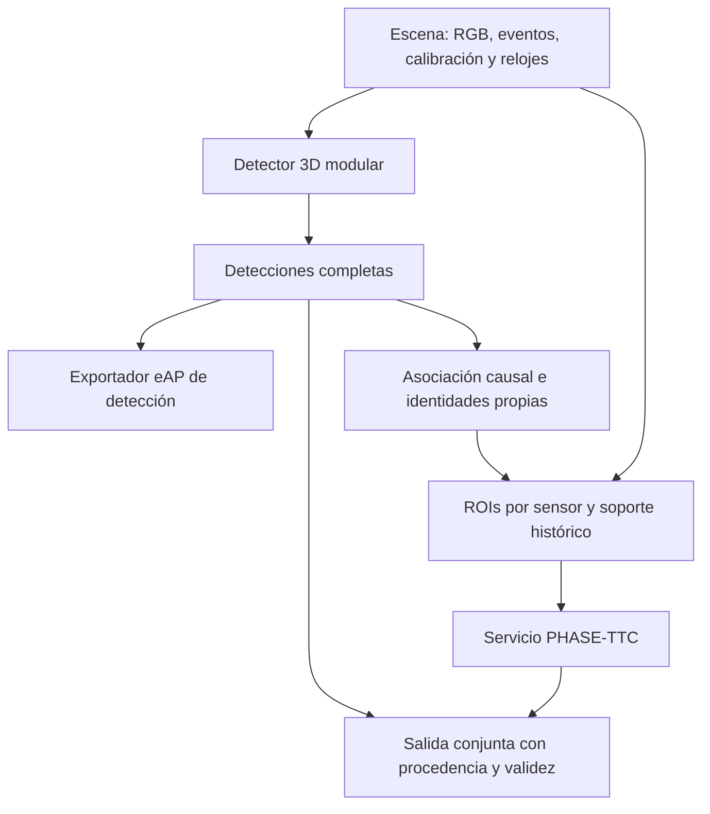
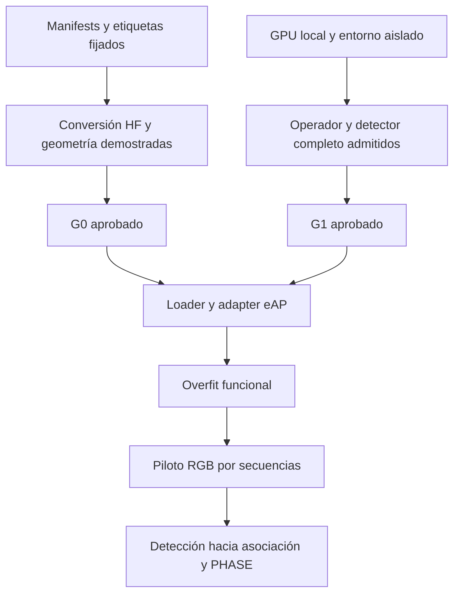

# PHASE-TTC: plan de desarrollo para detección 3D y asociación temporal

**Fecha:** 29 de octubre de 2026. **Versión:** propuesta v1 con auditoría ejecutada.

**Repositorio:** <https://github.com/Kripta-Studios/phase-ttc>. **Último `main` inspeccionado y base final:** `f2903f0bfd47d7bf56358a94ad5fac0b8a8906ef`, publicado el 29-10-2026 a las 11:56:49 +0100. **Rama local aislada:** `dev/eap-detection-g0-g1-20261029`.

La auditoría comenzó sobre `e58d0106e1f114f00f796987f70cd622cc6d186e` (29-10-2026, 10:49:54 +0100). Al comprobar `main` de nuevo apareció `f2903f0`: únicamente añade los dos informes previos en `docs/phase_3d_ttc_20261029/`, con SHA-256 idénticos a los adjuntos recibidos. Se inspeccionó ese diff y se avanzó el worktree mediante fast-forward, preservando todos los archivos nuevos. Código, AGENTS, artículo, resultados y manifests históricos son iguales entre ambos commits. Los recibos generados antes conservan su commit original; la verificación final usa la base nueva.

## 0. Decisión, alcance y estado de los gates

La siguiente arquitectura debe construirse por módulos: **detector 3D → asociación causal → preparación de ROIs → PHASE-TTC**. MonoDGP es el primer candidato de ingeniería; MonoDETR es el control de la misma familia. La selección es provisional y depende de geometría, operadores, memoria y aprendizaje real. No hay detector eAP entrenado en esta entrega.

El encargo contiene una instrucción inicial de planificación y después un alcance operativo explícito G0–G2 con entregables de implementación. Esta iteración aplica ese alcance posterior: implementa auditorías, contratos de comprobación y preparación reproducible; permite un piloto solamente después de G0 y G1. No modifica el artículo, la cadena TRAIN40 ni sus resultados.

| Gate | Estado al cierre de esta iteración | Evidencia obtenida | Condición pendiente |
|---|---|---|---|
| G0: inventario y etiquetas públicas | **Comprobación parcial superada** | Manifests fijados; 40 etiquetas train descargadas selectivamente y verificadas; 804.510 anotaciones; examen estructural del ZIP | Medios de la máquina del usuario no montados aquí |
| G0: contrato geométrico y causal completo | **BLOQUEADO** | Convención del visualizador original reproducida con fixture externo; relaciones entre campos HF comprobadas | Equivalencia original↔HF↔submission, rectificación RGB, velocidad y reproyección sobre medios reales |
| G1: preparación e inspección del entorno | **Comprobación parcial superada** | Entornos de auditoría separados, fuentes de ambos detectores fijadas, riesgos activos localizados | No constituye un entorno de entrenamiento admitido |
| G1: detector real en GPU | **BLOQUEADO** | Informes de preflight y de operadores con salida no satisfactoria explícita | Esta sesión no expone GPU NVIDIA, toolkit ni PyTorch; forward/backward/decode/memoria del detector sin ejecutar |
| G2: piloto RGB | **NO EJECUTADO; condicionado a G0 y G1** | Protocolo candidato por secuencias y tareas de implementación definidos | No se autoriza su lanzamiento mientras sigan bloqueados los gates anteriores |

**No se declara completado G0 ni G1.** Un test sintético, una instalación Python o una comprobación de dimensiones algebraicas no sustituyen los subgates restantes. No hay pérdidas de entrenamiento, AP, memoria de modelo ni tiempos de detector nuevos que reportar.

Entregables complementarios: [informe de ejecución](docs/detection_g0_g2_20261029/EXECUTION_REPORT.md), [auditoría G0](docs/detection_g0_g2_20261029/G0_DATA_GEOMETRY.md), [viabilidad G1](docs/detection_g0_g2_20261029/G1_DETECTOR_FEASIBILITY.md) y [revisión independiente](docs/detection_g0_g2_20261029/INDEPENDENT_REVIEW.md). Los JSON de evidencia están en `docs/detection_g0_g2_20261029/evidence/`.

### Convenciones de evidencia

- **H — Hecho comprobado:** código, bytes, metadatos o ejecución inspeccionados en esta sesión.
- **P — Publicado:** afirmación de una fuente primaria; no equivale a reproducción propia.
- **D — Decisión propuesta:** contrato o tarea futura; no implica implementación existente.
- **HIP — Hipótesis:** beneficio que necesita experimento comparativo.
- **B — Bloqueo:** información o capacidad necesaria que falta. Un bloqueo no se transforma en `PASS` por consenso de agentes.

Los agentes que colaboraron en esta entrega son revisores de IA, no autores de eAP ni un comité humano externo. La revisión final está separada de la autoría del código nuevo.

## 1. Estado real y preservación del proyecto

### 1.1 Git, artefactos y artículo

**H.** El directorio de trabajo inicial de la sesión no contenía un repositorio Git. Se clonó el repositorio solicitado y se creó un worktree nuevo desde `origin/main`. El worktree estaba limpio antes de los cambios. No se accedió al checkout, los discos `E:` ni el entorno de entrenamiento de la máquina del usuario. Por tanto, no se afirma haber auditado sus cambios locales ni haber reparado sus datos locales.

Se leyó `AGENTS.md` completo. Su actualización de nombre distingue el proyecto público PHASE-TTC de la hipótesis JEPA original; se conserva **`e_jepa_ttc`**, los IDs históricos y las rutas de checkpoints. El alcance nuevo autoriza RGB y detección; las prescripciones históricas sobre un primer MVP event-only no obligan a reconstruir ese MVP ni a ejecutar sus campañas antiguas.

Se inspeccionaron el artículo actual `paper/PHASE_TTC_Final.pdf` mediante sus fuentes LaTeX, sus registros de resultados y las implementaciones enlazadas. `python paper/scripts/verify_public_data.py` verificó **13 hashes**, **8 resúmenes de transferencia** y **12 campos del score TTC archivado**, además de recomputar el agregado. Esto comprueba la coherencia de la evidencia distribuida. No vuelve a ejecutar el modelo ni el scorer remoto.

El registro `paper/data/official_benchmark.json` conserva el resultado de **GarlTTC Test, competición 17289**, fechado 28-10-2026: submission 1016512, Overall MiD `35.80145158082389`, 6.762 tokens. Debe describirse como **evidencia oficial TTC archivada**. El propio registro advierte que el archivo del scorer no contiene el hash de las predicciones enviadas. No acredita un resultado oficial de detección 3D, el ranking actual ni una nueva evaluación en esta sesión. El scorer TTC original esperado por cuatro tests condicionales tampoco está incluido en este checkout. [S0, S1]

No se encontraron checkpoints `.pt`, `.pth`, `.safetensors` u `.onnx` en el checkout. Sí existen código, identidades, manifests y resultados. La inferencia TRAIN40 necesita recuperar los nueve componentes desde sus ubicaciones autorizadas y comprobar sus hashes; no puede sustituirlos por pesos aproximados.

### 1.2 Inventario para reutilización

| Pieza real | Archivo o símbolo | Reutilización y límite |
|---|---|---|
| Manifests eAP | `data/manifests/eap_train40_inventory_v1.json` | Inventario histórico con hashes, clases y secuencias; su geometría reconstruida no es evidencia independiente |
| Lectores eAP | `src/e_jepa_ttc/data/eap.py`: `load_eap_media_table`, `load_eap_sequence_labels`, `EAPEventReader` | Metadatos, etiquetas y ventanas HDF5; conservar lectura indexada |
| RGB en TAR | `src/e_jepa_ttc/rgb_port/data.py`: `TarFrameReader` | Acceso a miembros; no acredita rectificación ni equivalencia de cámaras |
| Proyección de cuboides | `data/eap.py`: `box_corners_ego`, `project_box_3d_to_event` | Asumen longitud sobre X, orden l/w/h y yaw positivo antihorario; no adoptarlos como conversor HF sin G0 |
| Targets reconstruidos | `data/eap.py`: `_local_linear_slopes`, `reconstruct_eap_object_states` | Supervisión/diagnóstico offline identificado; la pendiente local puede usar observaciones posteriores |
| Recorte común | `data/event_v4_geometry.py`: `common_square_from_boxes` | Preserva escala entre endpoints; no sustituir por crops ajustados independientes |
| Productores TTC | `models/causal_scale_ttc.py` y rutas `operational/` | Representaciones por objeto, geometría óptica y movimiento; no producen detecciones métricas de escena |
| Cabeza final | `operational/final_refit/training.py`: `PhaseOnlyFinal` | `[B,340]` y logits de anchura RGB `[B,2]`; selecciona 20 campos semánticos y calcula TTC/fase/q10/q90 |
| Predictor sellado | `operational/final_refit/test12.py` | Identidades y controles de nueve componentes; wrapper escalar de TTC |
| Servicio multiobjeto | `operational/train40_runtime/multiobject.py` | Entrada RAW compartida, ROIs e IDs externos; límite configurable 1–20, **por defecto 2** |
| Contexto batched | `operational/train40_runtime/batched_context.py` | Reconstruye los GRU por llamada; actualmente emite TTC final/evento/RGB y finitud, sin límites de fase |
| Export canónico de cabeza | `operational/final_refit/export.py` | Ya exporta TTC, fase y límites; no es un export sensor→detección→TTC |
| Admisión y caches | `train40_runtime/{feature_cache,multiobject_cache,rgb_immutable_history}.py` | Identidades estrictas de ROI, frames, modelo y batch; reutilización sujeta a esas claves |

**Falta:** loader de escenas de detección; transformaciones de etiquetas verificadas; detector y sus pérdidas/decodificador; evaluación 3D; asociación causal; estado de tracks; origen RAW eAP para el runtime; puente de ROIs predichas; transporte de cuantiles por la ruta elegida; calibración de esa ruta completa.

### 1.3 Límites que el plan debe conservar

TRAIN40 vio las cuarenta secuencias. Una nueva partición de esas secuencias no vuelve independientes sus predicciones TTC. Los 468 targets positivos de la transferencia etiquetada son desarrollo expuesto; las 434 consultas de la competición EvTTC sin correspondencia GT verificada solo permiten cobertura y desacuerdo. La fusión tuvo un perfil mixto frente a RGB en transferencia; ese resultado no prueba que eventos mejoren detección. El replay de 250 updates, un objeto y cinco segundos con RAW precargado obtuvo p95 29,14 ms y excluyó disco: no es un perfil de la arquitectura propuesta. [S1]

## 2. Revisión crítica de los documentos recibidos

Ambos MD aportados parten del mismo commit inspeccionado. Se conservan sus bytes y hashes en `evidence/inspection.json`; no se convierten en fuentes de implementación por haber recibido una revisión previa.

| Propuesta o afirmación previa | Dictamen | Corrección o decisión |
|---|---|---|
| Empezar modular y posponer backbone compartido | **Acuerdo** | Aísla errores de localización, identidad, recorte y TTC; mantiene el baseline histórico |
| Añadir salidas a las 20 variables finales sería suficiente | **Rechazado**, como ya advierten los MD | Esas variables son medidas por objeto; faltan representación espacial, asignación, pérdidas y decodificación de escena |
| Existe servicio multiobjeto y export de cuantiles | **Confirmado** | Evitar reimplementarlos; no confundir sus rutas o salidas |
| Rango actual 1–20 objetos | **Cierto con matiz** | Perfil por defecto 2; rango del constructor no equivale a carga medida ni límite del benchmark |
| Cero objetos: no llamar al servicio | **Incompleto** | No llamar al método TTC vacío, pero **sí avanzar sensores y relojes globales** |
| Más de veinte: procesar por chunks | **Incompleto y riesgoso** | Separar ingestión única de consultas; no repetir `update()` con el mismo paquete |
| IDs estables implican historia estable | **No demostrado** | Los GRU se reconstruyen y la ROI actual se aplica al RAW pasado; la identidad histórica exige un gestor externo |
| Reutilizar lectores del servicio sobre eAP | **Necesita adaptador** | Sus helpers de entrada usan layout EvTTC; reutilizar la frontera de arrays, no esos paths de HDF5 |
| RGB/eventos de 1280×720 pueden compartir ROI | **No demostrado** | Igual resolución no prueba rectificación, intrínsecos, parallax ni disponibilidad |
| Diferente orden dimensional prueba bug del helper | **No demostrado** | Existe una diferencia real, pero falta la equivalencia del release HF con el original; no tocar histórico a partir de una conjetura |
| `velocity` es velocidad útil para TTC | **Pendiente** | La web describe velocidad relativa; la relación exacta del campo HF, el filtrado y su marco no están cerrados |
| Un stack PyTorch moderno basta para Blackwell | **Falso como gate** | Las extensiones de ambos candidatos fijan arquitecturas antiguas y APIs CUDA/ATen obsoletas |
| Reducir resolución o queries soluciona memoria | **Requiere port coherente** | MonoDGP tiene escalados de pérdida y tamaños de grupo codificados; una edición aislada del YAML cambia o rompe la geometría |
| AP por distancia y errores ATE/ASE/AOE son oficiales localmente | **No verificado** | Faltan implementación y reglas del scorer 16717; el evaluador provisional llevará otro nombre |
| Descargar los nueve TAR de test es necesario para el piloto | **No** | Solo necesarios para una futura inferencia test completa; no participan en G2 |

La elección MonoDGP sigue siendo razonable como candidato, pero los informes anteriores subestimaban el trabajo concreto de port. MonoDETR comparte varias operaciones, así que no es una alternativa independiente a todos los fallos CUDA. ImVoxelNet cambia la familia, pero introduce su propio stack y volumen; también necesita su gate. [S5–S8]

## 3. Arquitectura objetivo y contratos entre módulos

### 3.1 Flujo propuesto



En G2 se implementa únicamente la rama RGB→detección. El lector de eventos puede auditarse en G0 sin alimentar al detector. El esquema de escena reserva el sensor para G3 y el puente G4; no anuncia una fusión ya implementada.

**D.** Mantener procesos o entornos separables: el detector puede producir registros serializados y ROIs que el entorno PHASE consume. No exigir que dos stacks incompatibles compartan un intérprete. Para el primer puente offline, Parquet/JSONL y arrays con contratos versionados son suficientes; compartir memoria y procesos residentes será una optimización posterior medida.

### 3.2 Contratos y responsabilidad

| Contrato propuesto | Contenido | Invariantes y responsable |
|---|---|---|
| `SceneSampleV1` | `sequence_id`, token, RGB uint8 HWC, referencias de eventos, calibración, clocks | Reader: tokens únicos; ausencia de medio es error explícito, no escena vacía |
| `SensorTimeV1` | `measurement_us`, `exposure_start_us`, `exposure_end_us`, `available_us`, clock_id | Admisión: no usar frame antes de exposición terminada y disponibilidad efectiva |
| `DetectionSetV1` | lista de cajas, clase, score, tiempos, source/model hash | Detector: score propio y todas las cajas válidas, sin filtrado TTC |
| `TrackObservationV1` | `track_id`, generación, estado, asociación, timestamp | Tracker: claves `(sequence_id, track_id, generation)`; ninguna identidad anotada de test |
| `ObjectROIV1` | ROI RGB/evento, crop común, proyección, clipping, calidad de soporte | Puente: transformación versionada, escala común, origen predicho y clocks auditables |
| `TTCResultV1` | TTC firmado, raw phase, emitted phase, q10/q90 y estados | PHASE: no reconstruir anchuras desde TTC; mantener saturación y productor del fallback |
| `JointSceneResultV1` | detecciones más track/TTC opcionales, estadísticas de cobertura | Orquestador: una falta de TTC nunca elimina una detección |

**D.** La representación interna tendrá centro geométrico, metros, dimensiones nombradas `length_m`, `width_m`, `height_m` y heading periódico. Como marco canónico de ingeniería puede usarse `vehicle_flu_v1` —X hacia delante, Y izquierda, Z arriba, yaw de mano derecha desde +X—. **Esta es una elección interna propuesta, no una afirmación sobre los ejes de HF.** La transformación HF→canónico permanece deshabilitada hasta G0. El adaptador registrará matriz, convención de yaw y referencia de centro, y el exportador volverá al marco exigido por eAP.

Ningún campo `size` sin nombres atraviesa los módulos. Cuando el detector necesite convenciones KITTI/cámara, el adaptador explícito las convertirá. No equiparar la altura vertical ego con una coordenada cámara ni añadir `h/2` a Y sin comprobar la rectificación y el sentido del eje vertical.

### 3.3 Esquema interno ilustrativo

Los valores `null` son parte del contrato. Este ejemplo describe un objeto nuevo, no una predicción producida por un modelo:

```json
{
  "schema": "phase_detection_joint_v1",
  "sequence_id": "sequence_example",
  "sample_token": "frame_example",
  "calibration_id": "sha256-of-verified-calibration",
  "times": {
    "measurement_us": 1000000,
    "exposure_end_us": 1000000,
    "sensor_available_us": 1001000,
    "detector_available_us": 1025000,
    "delivered_us": 1035000,
    "max_input_sensor_us": 1000000
  },
  "detections": [{
    "detection_id": "frame_example:0",
    "class_name": "car",
    "detection_score": 0.8,
    "box": {
      "frame": "vehicle_flu_v1",
      "center_reference": "geometric",
      "center_m": [15.0, 1.0, 0.8],
      "dimensions_lwh_m": [4.2, 1.8, 1.6],
      "yaw_rad": 0.0
    },
    "velocity": {
      "value_mps": null,
      "frame": "vehicle_flu_v1",
      "semantics": "relative_to_ego_at_measurement",
      "valid": false,
      "reason": "INSUFFICIENT_TEMPORAL_SUPPORT"
    },
    "track": {"id": "track_1", "generation": 0, "state": "tentative"},
    "ttc": {
      "signed_s": null,
      "raw_phase": null,
      "point_phase": null,
      "phase_q10": null,
      "phase_q90": null,
      "status": "INSUFFICIENT_IDENTITY_HISTORY",
      "producer": null,
      "interval_calibration": "NOT_CALIBRATED"
    }
  }]
}
```

Los tiempos ilustrativos no son mediciones ni compromisos de latencia. En ejecución, tiempo de sensor y reloj monotónico del host requieren una correspondencia explícita; se conservarán ambos si no comparten origen. No restar timestamps de relojes distintos para fabricar latencia.

El JSON eAP tendrá solo el `meta` documentado y `results[token]` con los seis campos `class_name`, `translation_m`, `size_lwh_m`, `yaw_rad`, `velocity_mps`, `score`. Mantener un archivo interno separado para TTC e identidades. El README HF documenta esas claves; el ZIP vacío por sí solo no prueba el esquema por caja. La semántica de los valores y su admisión por el scorer siguen pendientes. [S3]

Validación futura del export: nombres de ocho clases exactos, dimensiones positivas, números finitos, score en [0,1], cada token una vez, ausencia de claves extra por caja. **El score nativo de MonoDGP multiplica la puntuación de clase por `exp(-log_variance)` y puede superar 1.** Conservar `native_detection_score` bruto y sus componentes en el artefacto interno. Para el primer piloto se propone usar la puntuación de clase sigmoid como `detection_score` exportable y registrar `score_policy=class_sigmoid_v1`; comparar después la ordenación nativa como experimento separado sobre selección. Esta política debe verificarse con el contrato del scorer antes de cualquier equivalencia oficial. No aplicar clamp silencioso, ni llamar probabilidad calibrada a cualquiera de los dos scores. Cero detecciones produce `[]`; medio no leído produce un fallo de ejecución y nunca se disfraza como `[]`. Si falta velocidad, se conserva `null` en el artefacto interno; no inventar ceros para crear una submission. No se enviará ninguna en esta iteración.

## 4. G0: datos, geometría, calibración y causalidad

### 4.1 Datos revalidados y alcance de la descarga

**H.** HF eAP se fija a `a814a946e60d37f7242358af5f344542177e50c5`; el repositorio original a `2c5f3a74ba5b693b746820a0a355684e3597dc2d`. Se descargaron manifests/README/metadatos pequeños y **solo los cuarenta `data/train/*/labels.parquet` previamente identificados**, 128.416.244 bytes de etiquetas. No se descargó el dataset completo, HDF5 ni RGB. Los datos crudos quedan fuera de Git. [S2, S3; `evidence/g0_audit.json`]

| Población inspeccionada | Resultado real | Alcance |
|---|---|---|
| `data/train.parquet` | 118.247 frames, 40 secuencias | Hash coincide con inventario histórico |
| `data/test.parquet` | 35.940 frames, 12 secuencias | Solo metadatos/contrato de tokens, sin targets ni selección |
| Cuarenta etiquetas train | 804.510 filas, hashes verificados | Auditoría de estructura, clases, correspondencias y relaciones numéricas |
| Clases | car 496.284; truck 179.441; motorcycle 80.997; pedestrian 29.377; bus 10.210; tricycle 5.559; bicycle 2.069; other_vehicle 573 | Conteos de anotaciones, no objetos independientes ni soporte de cada split/piloto |
| Medios train | Manifest referencia 40 HDF5 y 136 TAR | Existencia en `E:` era un hallazgo anterior; aquí no están montados |
| Nueve TAR test señalados | Referencias y tamaños remotos verificables | No descargados; no son requisito de G2 |
| `sample_submission.zip` | Un `submission.json` con 35.940 listas vacías | Verificación de estructura y tokens; no evidencia de detecciones |

La descripción del proyecto eAP anuncia 46 secuencias train y 58 totales, además de cifras de anotaciones de su publicación. El release HF fijado contiene 40+12. El plan usa los archivos fijados; no atribuye las seis secuencias ausentes ni las diferencias de conteos a un error sin reconstruir el alcance de cada publicación. [S3, S4]

La cifra histórica de 4.132 frames afectados por nueve TAR ausentes se refiere al inventario de aquella máquina, no al estado de este contenedor. Se puede recalcular su impacto sobre el manifest, pero no afirmar que aquí se han reparado 4.132 imágenes. No volver a descargar esos TAR para diagnosticar entrenamiento.

### 4.2 Evidencia geométrica obtenida

**H.** El README original describe `[x,y,z,l,h,w,yaw]`, Z-up y `T_event_ego` de ego a cámara evento. El visualizador ejecutable ubica ancho sobre X local, longitud sobre Y local y altura sobre Z, rota con yaw positivo horario en XY y usa centro geométrico. El fixture externo distingue un cuboide no cúbico y varios yaw; no utiliza el helper local para generar su propia verdad. [S2]

**H.** En las 804.510 filas HF inspeccionadas se cumple:

```text
size == bbox_3d_ego[[5,3,4]]
yaw == bbox_3d_ego[6]
translation == ego_translation == bbox_3d_ego[:3]
velocity == velocity_3d[:2]
velocity_3d[2] == 0
```

Esto verifica relaciones algebraicas. **No identifica automáticamente el significado físico de cada dimensión, el signo global del yaw ni el marco de velocidad.** `ego_translation` coincide aquí con el centro del objeto; no es una pose del vehículo para ego-motion. [Auditoría G0]

**B.** Falta una pareja de la misma anotación en bundle original y HF o el conversor oficial. Falta también demostrar la relación con `size_lwh_m` del submission. No se modifica `box_corners_ego` histórico, ni se autoriza entrenar a partir de esa suposición.

### 4.3 Lista de cierre de G0 por subgate

| Subgate | Trabajo pendiente concreto | Prueba y criterio de aceptación |
|---|---|---|
| G0-A integridad local | Ejecutar auditoría global con raíz real y hashes; abrir HDF5 y miembros TAR usados en el alcance admitido | El auditor actual exige todos los medios referenciados por las 40 secuencias train. Una admisión limitada al piloto necesita antes el ticket de scope de NEXT-01, con tokens y hash; nunca reinterpretar un fallo global como PASS |
| G0-B dimensiones y centro | Obtener conversor o correspondencias original/HF; documentar cada permutación | Golden externo con l≠w≠h, centro elevado, yaw 0 y ±π/2; esquinas coincidentes con referencia a tolerancia numérica registrada |
| G0-C yaw y ejes | Determinar heading, mano, cero, wrap y simetrías | Heading longitudinal y esquinas tras cambio de marco; probar ±π y giro con extrínseca no identidad |
| G0-D extrínsecas | Validar `T_event_ego`, inversión, ortonormalidad, unidades y determinante | Puntos delante/detrás, origen y traslación conocida; proyección independiente, sin invertir por el nombre de la variable |
| G0-E RGB/eventos | Identificar K RGB, distorsión, rectificación, crop/resize del PNG, o conversor que produzca vista evento | Reproyecciones emparejadas en train, objetos próximos/lejanos, centro/bordes y oclusiones; conservar overlays y residuos |
| G0-F velocidad | Fijar absoluta/relativa, marco, unidades, intervalo, filtrado y componente vertical | Ejemplo estático con vehículo en movimiento y ejemplo móvil; comparar derivadas en un marco común con ego-pose verificada |
| G0-G causalidad | Relacionar exposición, eventos y disponibilidad; revisar duración y huecos | Ningún input posterior al query; replay de prefijos invariante al añadir o alterar el futuro; rechazo de llegadas tardías |
| G0-H protocolo | Congelar clases, split, targets, máscaras, priors y reglas de ignorado | Ninguna secuencia compartida; priors solo train; sesiones relacionadas agrupadas si existen metadatos |

La reproyección real se hará **sobre train**, con selección de ejemplos por geometría/metadatos anterior al entrenamiento. Un panel sintético acredita la fórmula que representa; no demuestra calibración del release. Registrar token, archivo, hash, calibración, esquinas ego/cámara, píxeles y si hubo clipping. No seleccionar solo ejemplos visualmente bonitos. Revisar también no intersección, caja parcialmente detrás de cámara, truncamiento e intrínsecos modificados por resize.

No convertir un cuboide inclinado por la extrínseca en yaw puro cámara sin verificar la aproximación. MonoDGP aprende profundidad con priors de perspectiva y altura; necesita una vista rectificada compatible o una adaptación geométrica explícita. Una matriz 4×4 correcta no elimina esta restricción del modelo.

### 4.4 Causalidad y velocidad no son sinónimos

Para un query anclado al final de exposición, exigir `exposure_end_us <= query_sensor_us` y que la observación se encuentre disponible cuando se toma la decisión. La ventana de visualización oficial centrada en exposición puede extenderse más allá del instante declarado: no copiarla como ventana causal. Usar intervalos de eventos definidos, por ejemplo `[t-W,t)`, con inclusión de bordes registrada y probada.

Una anotación de velocidad calculada offline puede ser un **target** de entrenamiento si se documenta; no puede entrar como feature en inferencia. La derivada central de posiciones anotadas usa futuro. Incluso diferencias atrasadas en coordenadas ego móviles necesitan compensar traslación y rotación del vehículo antes de interpretarse físicamente. Sin poses temporales verificadas, no usar `ego_translation` como sustituto.

La ecuación diagnóstica `tau=-Z/(dZ/dt)` requiere profundidad óptica y derivada relativa con el mismo punto de referencia. Centro y superficie frontal producen TTC distintos. Esta consistencia no se incorporará como pérdida ni filtro de scores hasta cerrar esos contratos.

## 5. G1: selección y viabilidad del detector

### 5.1 Selección condicionada

| Candidato | Motivo para evaluarlo | Barrera real | Decisión |
|---|---|---|---|
| MonoDGP | Detector monocular con geometría/profundidad y decoder 2D separado; fuentes y pesos publicados | Operadores antiguos, supuestos KITTI y pérdidas con constantes espaciales | Primero para un port acotado y verificable |
| MonoDETR | Control cercano de profundidad/transformer; ayuda a aislar complejidad añadida | Comparte deformable attention y varios supuestos KITTI | Control, no garantía de rescate CUDA |
| ImVoxelNet | Alternativa monocular de proyección a vóxeles; cercana a la familia eAP | MMDetection3D/MMCV, memoria del volumen, otros kernels | Solo si el port anterior falla o deja de ser acotado |
| Métodos temporales/multivista | Posible mejora posterior de memoria de objetos | Ego-motion, señales y stack adicionales no verificados | Fuera de G0–G2 |

La publicación de MonoDGP justifica investigar sus priors geométricos, no transferir AP de KITTI a eAP. El protocolo eAP usa otra población, clases y definición de matching. No comparar los valores de sus leaderboards ni prometer un ganador. [S5–S8]

**Fuentes fijadas:** MonoDGP `aa059a18214aebf644510e7f0793971b403f9d14`; MonoDETR `6994b9f512400b258c6edb75f77423beb9c126f2`. Se inspeccionaron licencias MIT de raíz y cabeceras de la operación deformable heredada. La licencia de código no determina por sí sola los derechos de datos o checkpoints. No redistribuir medios eAP ni pesos sin revisar sus términos.

### 5.2 Port necesario, identificado en código activo

| Área | Hallazgo en upstream | Tarea concreta propuesta |
|---|---|---|
| CUDA | `ops/setup.py` fija `-arch=sm_60` y gencode sm60/61/70/75 | Detectar capability real, adaptar build al toolkit verificado, preservar patch y logs |
| ATen/CUDA | Incluye `THC/THCAtomics.cuh` y dispatch con `value.type()` | Migrar API solo en copia aislada y comprobar forward/gradientes contra referencia |
| Dataset | Tres clases KITTI, writelist car, máximo 50 objetos y filtros por dificultad/distancia | Crear loader eAP; no copiar filtros ni truncar GT a 50 sin contabilidad |
| Resolución | 1280×384 nativa; `loss_depth_map` contiene `[80,24,80,24]` | Derivar escalas del shape real; prueba rectangular y actualizaciones de K/targets |
| Profundidad | Binado activo con 80 bins/rango 60 m; filtros KITTI 2–65 m | Unificar rango/bins en contrato; cobertura train, out-of-range explícito; no descartar lejanos silenciosamente |
| Prior geométrico | `monodgp.py` calcula altura 3D / altura en píxeles y multiplica `calibs[:,0,0]` (`fx`) | Probar contra proyección independiente con `fx != fy`, resize anisótropo y rectificación; fijar uso de `fy` o formulación válida para la vista. Actualizar K por sí solo no prueba el prior |
| Queries | Rutas activas de transformers usan `group_num * 50` al entrenar | Port coherente si cambia tamaño del grupo; probar divisibilidad, matching y grupos train/eval |
| Device | Pérdida angular contiene `.cuda()` | Usar device/dtype del tensor; verificar CPU de referencia y CUDA seleccionado |
| Decode | Salida KITTI h/w/l, desplazamiento a centro inferior y score clase × `exp(-log_variance)` sin cota superior | Decodificador eAP independiente con centro geométrico; conservar score nativo y aplicar política exportable explícita de §3.3 |
| Velocidad | No existe una cabeza equivalente al objetivo eAP | Añadir salida supervisada con máscara después de verificar semántica; no rellenar con cero |

La clase `QuerySelection` con defaults 11×50 existe, pero no es la evidencia decisiva porque no se instancia en la ruta seleccionada. Las restricciones citadas se verificaron en los transformers activos y en `bin_depths`. No presentar código muerto como causa del port.

### 5.3 Entorno y prueba que realmente cerraría G1

**H.** Se crearon entornos separados para auditorías. No se cambió `pyproject.toml`, `uv.lock` ni el entorno PHASE. La máquina accesible tiene Python 3.12.14 y carece de dispositivos NVIDIA visibles, `nvidia-smi`, `nvcc` y Torch instalado. La RTX 5070 Ti Laptop de 12 GB es el hardware objetivo documentado previamente, no un recurso accesible aquí.

**D.** En la máquina objetivo, empezar por un entorno Linux/WSL separado con Python y PyTorch/CUDA compatibles, tomando el entorno histórico 2.11.0+cu128 como candidato a comprobar, no como dependencia garantizada de upstream. Verificar la pareja torchvision y sus wheels, compilador, driver y arquitectura real. El anuncio oficial de soporte Blackwell en PyTorch 2.7/CUDA 12.8 no verifica las extensiones de los detectores. [S9]

Secuencia obligatoria, registrando salida y exit code:

1. Inventario del host, driver, capability, Torch/torchvision, CUDA toolkit, compilador y paquetes; comprobar que no cambió PHASE.
2. Build de la extensión con fuente y patch fijados; guardar stdout/stderr, comandos, archivo binario y SHA-256.
3. Paridad de deformable attention contra la referencia PyTorch: forward y gradientes FP32/FP64 sobre pequeños tensores no triviales, distintas shapes y puntos de muestreo. Los tests upstream que solo imprimen booleanos no bastan.
4. Forward **del detector completo** en train/eval con batch 1, inicialización reproducible y shape nativa. Sin descarga automática de pesos durante el smoke.
5. Criterio completo, pérdida total y cada componente finitos; backward, normas de gradiente por módulo y actualización real de parámetros entrenables. No exigir gradiente a parámetros deliberadamente congelados.
6. Decoder con salida finita; fixture sintético con cajas vacías, una y varias cajas; chequeo de centro, dimensiones y yaw. El contrato eAP se prueba después de G0; el smoke nativo no lo acredita.
7. Varias iteraciones para alcanzar estado estable; `cuda.synchronize()` en los límites; `max_memory_allocated` y `max_memory_reserved`, más memoria del proceso/dispositivo y configuración.
8. Guardado/relectura y repetición del smoke con mismo entorno; pruebas de no finitos y OOM explícitos. Una excepción no se convierte en una caja vacía.

G1 solo pasa con evidencia de **modelo + pérdidas + backward + decode + operadores + memoria**. El script de preflight de esta entrega devuelve siempre G1 bloqueado porque solo inventaría requisitos; el checker de operadores puede admitir esa operación concreta, nunca el detector completo.

El primer smoke no mantiene productores TTC residentes. La inferencia conjunta tiene otro perfil de memoria y se medirá en G4. Empezar por batch 1 y FP32; AMP, cambios de tamaño, queries, checkpointing de activaciones y acumulación son controles posteriores. Acumular gradientes no reduce las activaciones de un ejemplo.

### 5.4 Regla de cambio de candidato

Si el port se limita a APIs/builder y pasa la referencia numérica, continuar MonoDGP. Si exige reescribir partes sustanciales de atención o de pérdidas sin oracle, registrar el fallo y evaluar MonoDETR con el mismo gate. Si falla el operador compartido, no repetir un entrenamiento del control: evaluar ImVoxelNet con una versión fijada de MMDetection3D y perfil de volumen explícito. No se fija un número de días ni se presenta esta alternativa como ya compatible.

## 6. G2: piloto RGB preparado, todavía no ejecutado

### 6.1 Partición y admisión

Se añadió `src/e_jepa_ttc/detection/protocol.py` y el CLI `scripts/prepare_detection_protocol.py`. Generan una partición determinista a partir **solo de filas `split=train`**, con hash de manifest y revisión HF. Validan roles exactos, duplicados, cobertura, intersección y grupos de sesión cuando se aportan. Rechazan test y revisiones abreviadas; no sobrescriben un split existente.

`data/splits/eap_detection_candidate_v1.json` propone **24 train / 8 selección / 8 calibración**, semilla 7, orden SHA-256 de `seed:sequence_id`. Su estado es `CANDIDATE_METADATA_ONLY`: no autoriza entrenamiento, no es un nuevo test y no elimina exposición de TRAIN40. El reparto es independiente de métricas de modelos. Antes de congelarlo, registrar soporte de clases/condiciones y si varias secuencias pertenecen a una misma adquisición. Si aparecen sesiones relacionadas, agruparlas y versionar la partición antes de experimentar.

**D. Piloto mínimo propuesto:** entrenar con `8SdieOgbva` y `qGsgzl4Q8B`; evaluar localmente `OBneIVg4Cw` y `pBqGOb2vYq`, todas incluidas en sus roles respectivos del candidato. La elección usa metadatos de entrenamiento y soporte de clases; `8SdieOgbva` contiene anotaciones de las ocho clases. Los frames concretos deben congelarse tras comprobar los medios, no tras observar predicciones. Una clase presente en toda una secuencia puede no aparecer en los frames muestreados: publicar ambos conteos.

El runner futuro debe abortar si G0 no está aprobado, si G1 no contiene un smoke real admitido, si cambia cualquier fuente/config/split ligado a ellos o si intenta acceder a un token fuera de train/selección autorizados. La calibración queda sin utilizar durante selección. Ningún path de GarlTTC test participa en el loader.

### 6.2 Adaptación de modelo y targets

Crear `src/e_jepa_ttc/data/eap_detection.py` con una escena por muestra y conjunto de objetos variable. Mantener negativos reales, separar frame sin GT de label file ausente y conservar objetos que el modelo no pueda representar en la contabilidad. Derivar K después de crop/resize/padding mediante una transformación de imagen documentada. Verificar también el prior altura→profundidad: en una cámara rectificada con altura vertical y aproximación frontal corresponde `fy`, mientras upstream usa `fx`; incluir fixtures con focos distintos y resize anisótropo antes de elegir la adaptación. Si la vista no permite esa aproximación, documentar y probar otra formulación o bloquear esa ruta. Deshabilitar flips y crops geométricos para el primer overfit.

Mantener las pérdidas/matching de referencia cuando sean compatibles; registrar cada modificación. Ocho logits de clase con mapeo explícito, profundidad/centro, dimensiones y orientación según contrato verificado. Calcular priors dimensionales solo con el role train. Si se usa pretrained, registrar origen, hash y población; cargar capas compatibles y reinicializar cabezas nuevas. No cargar silenciosamente clases o medias KITTI como eAP. El smoke se ejecuta sin pretrained para separar viabilidad de acceso a pesos; el piloto puede usar backbone ImageNet público fijado cuando se verifiquen términos/bytes.

Añadir velocidad únicamente con target validado, máscara de disponibilidad y pérdida separada. Una imagen única no identifica movimiento instantáneo por sí sola: el head monocular es una predicción aprendida que se evaluará como tal. El seguimiento causal posterior puede mejorarla. Si el contrato de velocidad sigue abierto, G0 sigue bloqueado conforme al encargo; no declarar el piloto completo con una velocidad ficticia.

### 6.3 Dos ejecuciones distintas

| Ejecución propuesta | Inputs y presupuesto de prueba | Qué demuestra | Criterio de salida |
|---|---|---|---|
| Overfit funcional | 16 frames de train, selección determinista con positivos/negativos si existen; augmentations off; batch 1; límite 200 updates | Targets, pérdida, optimización y decode conectados | Pérdidas/gradientes finitos; descenso de pérdidas principales; mejora frente a inicialización en las mismas cajas; inspección de reproyección y checkpoint reproducible |
| Piloto por secuencias | Hasta 128 frames por cada una de las dos secuencias train y 128 por cada una de las dos de selección, repartidos temporalmente; batch 1, acumulación 4; máximo 5 épocas | Funcionamiento sobre escenas excluidas del fit y coste medido | Predicciones/GT completos, métricas locales reproducibles, desglose por secuencia/clase, ningún acceso a test ni pérdida de filas |

Son límites propuestos de cómputo, **no tiempos de entrenamiento ni promesas de precisión**. Congelar los tokens y el criterio numérico de descenso del overfit antes de lanzarlo. Como gate funcional inicial se propone reducción de al menos 50% de la pérdida de centro respecto a la mediana de las primeras veinte actualizaciones, sin explosión de las demás pérdidas. Si esa parametrización no permite interpretar el criterio, corregir y versionar el gate antes del run, nunca reducirlo después para aprobar. El recall en el tiny set se informa como diagnóstico de sobreajuste, no como generalización.

El piloto termina al presupuesto fijado y evalúa una vez el checkpoint designado. No iniciar un sweep por un resultado débil. Si se usa selección para escoger checkpoints o corregir el modelo, sus resultados se etiquetan desarrollo. No se requiere mejora SOTA para considerar funcional un pipeline; sí se exige ausencia de fallos silenciosos y aprendizaje comprobable.

### 6.4 Artefactos obligatorios del piloto futuro

Cada ejecución creará `config_resolved.yaml`, `run_manifest.json`, `environment.freeze.txt`, `source_patch.diff`, `stdout.log`, `losses.jsonl`, `checkpoints/`, `predictions.parquet`, `metrics_development.json`, `resources.json` y overlays de train/selección. El manifest contendrá commit base, commit nuevo o patch hash, configuración y split hash, revisión/hashes HF, semilla, inicialización, fuentes pretrained, unidades/marcos, exclusiones y su motivo.

Registrar estados `STARTED`, `FAILED`, `COMPLETED` y `INVALIDATED`; checkpoint incompleto nunca es `COMPLETED`. Guardar recursos observados aunque el run falle. No incluir targets test, credenciales ni datos crudos en Git. Las métricas agregadas deben regenerarse desde predicciones, no transcribirse manualmente.

## 7. Evaluación y calibración: separar las afirmaciones

### 7.1 Scorer 3D y métricas de desarrollo

El enlace oficial de detección es competición **16717**, distinta de TTC **17289**. La recuperación web de la página de detección devolvió contenido ajeno, no un contrato utilizable. No se obtuvo en esta sesión un scorer autenticado/versionado de detección. El README HF permite comprobar formato; no determina interpolación de AP, reglas TP, rangos, simetrías, clases sin GT o cajas máximas. [S2, S3, S10]

**D.** Implementar primero un perfil explícitamente llamado `eap_center_dev_v1`, sin claim de réplica oficial. Propuesta para preregistro:

- matching por frame y clase, orden descendente por score con desempate por ID estable;
- distancia entre centros en XY del marco ego validado, umbrales 0,5/1/2/4 m, frontera `<=` declarada;
- matching uno a uno y greedy al GT más cercano no asignado; AP interpolada a 101 recalls, definición exacta versionada;
- AP por clase/umbral y macro de las clases con soporte, publicando las clases excluidas por cero GT y sus falsos positivos;
- ATE, ASE y AOE de desarrollo a matching 2 m: distancia planar; `1-IoU` de tamaños alineados; error angular envuelto, inicialmente periodo 2π;
- ningún filtro de TTC, ningún top-20 heredado del servicio, ninguna eliminación silenciosa de no finitos o frames difíciles.

Estas definiciones son **propuestas locales**, no una atribución a eAP. La métrica ASE usa dimensiones completas 3D, con centros/orientaciones alineados; AOE por clase deberá cambiar si el scorer prescribe simetrías. Se publicará también error Z y error de velocidad, que no quedan caracterizados por matching planar.

Fixtures: predicción perfecta, FP sin GT, duplicado sobre el mismo GT, FN, clase incorrecta, empate de score, fronteras exactas, error solo vertical, yaw ±π y clase sin GT. Cuando se consiga el scorer oficial, fijar hash y comparar **las mismas predicciones** en fixtures y datos train; documentar diferencias antes de renombrar métricas. No modificar objetivos para imitar retrospectivamente un score visto en test.

### 7.2 Independencia y exposición

Hay dos carriles distintos:

1. **Operativo:** detector excluye sus secuencias de selección; PHASE TRAIN40 congelado sirve para interfaces, paridad y costes. Todo TTC sobre esas cuarenta secuencias se etiqueta `development_exposed`.
2. **Generalización conjunta:** todo productor, teacher, normalizador, selector, calibrador y cabeza que influya en la salida evaluada excluye los grupos correspondientes. Generar ROIs/features fuera de fold para las etapas posteriores. La exclusión debe cubrir pretraining supervisado y no supervisado/SSL sobre esas secuencias, adaptación y selección, no solo el optimizador final. Si se usa exposición sin etiquetas a los grupos evaluados, declararlo protocolo transductivo separado; no presentarlo como evaluación inductiva sin exposición.

La AP del detector puede conservar su exclusión propia si PHASE solo está downstream y no altera cajas, scores, pérdidas, filtrado o selección. En cuanto TTC retroalimente al detector, revisar de nuevo la matriz de exposición. Un refit all-TRAIN40 cambia la población de productores respecto a OOF; no hereda automáticamente la calibración de los folds.

Para resultados principales posteriores: semillas 7/13/23, misma definición de presupuestos, diferencias pareadas y bootstrap por secuencias completas. Indicar qué se reentrena en cada semilla: tres cabezas con el mismo backbone no son tres réplicas de todo el sistema. El piloto de una semilla solo acredita su alcance limitado.

### 7.3 TTC e incertidumbre

Mantener separadas puntuación de detección, incertidumbre geométrica, ambigüedad de asociación y límites de fase. No llamar `confidence` a una cantidad sin definición. `q10` y `q90` no acreditan cobertura del 80%.

La transformación actual acepta `T<0` o `T>0.1 s`, satura la inversa en magnitud 60 s y asigna fase cero a +60 s. El punto emitido se transforma de vuelta después de saturar; los límites se calculan desde la ubicación y anchuras nativas. Conservar `raw_phase` y `point_phase` separados. Si un intervalo cruza cero, ordenar sus extremos transformados no produce un intervalo TTC continuo ordinario. Probar cruce estricto, cero desde cada lado y singleton cero. [S1; `simplex_t/phase.py`]

Calibrar en secuencias reservadas una vez exista el puente. Si el productor es TRAIN40 congelado, reservar secuencias para el calibrador no elimina su exposición previa: esa calibración y su evaluación siguen siendo desarrollo expuesto. Reportar cobertura y anchura en fase, saturación, ambigüedad de signo y curvas riesgo–cobertura por clase/condición. Para TTC: MAE, mediana, p95, error de signo y cobertura sobre todas las consultas elegibles con verdad verificada. FP, misses y abstenciones se reportan aparte; una caída de MAE al emitir solo en objetos fáciles no es una mejora completa. No afirmar garantías conformales sobre ventanas correlacionadas ni usar etiquetas privadas para adaptación online.

## 8. Puente hacia el servicio multiobjeto

Esta sección especifica **G4 futuro**. No se implementó el puente en G0–G2.

### 8.1 Frontera real del servicio

`ObjectRegion` contiene `object_id`, `event_square`, `rgb_square`. `RawRGBHistory` contiene `query_us`, frames uint8, timestamps y triplets. `infer_prepared()` exige eventos `[N,4,3,12,128,128]` y N dentro de la capacidad configurada. Los cuatro anchors cubren query−300/200/100/0 ms y cada observación reúne tres ventanas de 100 ms. El soporte total de eventos llega a 600 ms; RGB admite hasta 650 ms y ocho observaciones. [S0, código `train40_runtime`]

La ruta prefix exige ingestión contigua exacta de 20.000 µs. El selector RGB busca separación cercana a 100 ms con tolerancia 1 ms. Los timestamps irregulares de eAP no deben redondearse a esa cuadrícula sin evidencia de paridad. **Primera opción para corrección:** backend de lectura exacta de ventanas con `EAPEventReader`; optimizar con prefix solo después de demostrar equivalencia y medir su coste.

### 8.2 Orquestación propuesta

1. `ingest_scene_packet(packet,start_us,end_us,packet_id)` avanza RAW exactamente una vez aunque no haya detecciones. Rechaza duplicado, rollback y discontinuidad no declarada.
2. El detector procesa un frame realmente disponible y devuelve detecciones con timestamp de medida y de finalización. Se asocian solo observaciones disponibles; ningún interpolador bilateral ni suavizado offline alimenta inferencia.
3. `snapshot(query_us)` fija la generación de buffers y frames. El query puede ser el tiempo de medida retrospectivo; la salida no se anuncia disponible en ese pasado.
4. `prepare_regions(snapshot,detections,tracks)` crea ROIs por sensor y soporte de identidad. Primero reproduce el recorte retrospectivo de la ruta entrenada. Historial con cajas móviles por endpoint será otra representación que necesita experimento.
5. Para N=0, emitir detecciones vacías y conservar la ingestión. Para N>capacidad, consultar e inferir secuencialmente en chunks. **Nunca repetir `update()` para el mismo paquete.**
6. `query_many()` presta almacenamiento que la siguiente consulta puede sobrescribir. Consumir cada chunk antes de consultar otro o adquirir una copia/lease explícita. No lanzar calls concurrentes sobre un mismo servicio.
7. Combinar resultados sin alterar orden/identidad; exportar todas las detecciones. Ante fallo TTC, campo ausente con causa y receipt, no eliminación de la caja.

### 8.3 Asociación, ROIs e historia

**D.** Baseline de asociación: matching causal interpretable, por clase compatible y gates de tiempo/posición, con Hungarian. Empezar con detecciones fijas para comparar gates 2D y 3D; el 3D monocular debe modelar incertidumbre de profundidad. Sin ego-motion validado, evitar un filtro de velocidad en un marco ego supuesto fijo: usar una asociación 2D conservadora o marcar la parte métrica indisponible. AB3DMOT y ByteTrack son referencias, no implementaciones ya integradas. [S11, S12]

Lifecycle: `tentative → confirmed → lost → closed`, con generación nueva si no se demuestra continuidad. Fijar thresholds por validación, no por test. No completar trayectorias con interpolación futura. El registro de asociación incluye candidato elegido, distancia/coste, margen frente a la segunda opción y razón de rechazo.

| Caso | Política propuesta |
|---|---|
| Nacimiento | Entregar detección; distinguir buffer sensorial disponible de identidad verificada. TTC puede abstenerse hasta tener soporte suficiente |
| ROI con jitter | Mantener coordenadas comunes; comparar crop 2D visible y proyección 3D. No suavizar tamaño sin comprobar que conserva expansión |
| Oclusión parcial | Guardar visibilidad/truncamiento; medir degradación. No inventar observaciones del objeto oculto |
| Pérdida temporal | Track `lost`; predicción de movimiento etiquetada como predicción, sin reutilizar TTC como medida actual |
| Reaparición ambigua o ID switch | Nueva generación o invalidación de historia/receipts/caches del track; otros objetos siguen intactos |
| Cambio de clase | Mantener distribución/evidencia y aplicar política de compatibilidad; no reutilizar silenciosamente historia incompatible |
| Falta de RGB | Fallback event-only solo si su contrato se satisface; productor y límites propios explícitos |
| Historia incompleta | `ttc=null`, reason estructurada; no repetir frames o rellenar eventos para simular historia |
| Gap o rollback global | Reset de sensor/caches con nuevo segmento temporal; no borrar las detecciones ya válidas del pasado |

Los GRU actuales se reconstruyen por llamada. Un ID switch no se arregla borrando un hidden state persistente que no existe; se invalida la historia lógica y su pertenencia. La ROI actual reaplicada al pasado puede contener otro objeto: medir contaminación de los últimos 650 ms, además de IDF1/HOTA.

### 8.4 Cache y cuantiles

Las claves RGB existentes vinculan ROI exacta, object_id, bytes/clocks de frames, modelos, precisión y batch/slot. `RGBBatchCache.begin()` retiene solo objetos de la llamada; chunks sucesivos pueden expulsarse entre sí. Empezar el puente sin reutilización entre updates o añadir retención por escena probada. Un cache hit nunca reemplaza recomputar edades y contexto causal.

Para límites de fase, implementar una ruta batched nueva/aditiva que conserve el hidden RGB necesario para `width`, suministre los logits `[B,2]` a `PhaseOnlyFinal` y compare punto/límites contra el export canónico. No derivarlos del escalar final ni copiarlos al fallback event-only. Mantener compatibilidad de la salida histórica y hashes originales; una ruta modificada recibe identidad nueva.

Pruebas de aceptación: cero, 1, 2, 20, 21 y 41 objetos; ingreso único; no pérdida de detecciones; reordenamiento; cambio de ROI/ID; aparición y salida; cruce/oclusión; frame tardío; futuro alterado; gap/rollback; paridad de fase/cuántiles; batch shape/caches; perfil completo con modelos residentes.

## 9. Fases, dependencias, archivos y criterios de aceptación

**Convención:** «nuevo en esta entrega» identifica código que sí existe; «futuro» identifica un archivo/tarea todavía no implementado. Los nombres futuros fijan responsabilidades para el siguiente agente, no simulan APIs ejecutables.

| Fase y dependencia | Archivos principales | Tareas concretas | Pruebas y entregables | Criterio de paso |
|---|---|---|---|---|
| G0.1 — independiente | Nuevos: `detection/data_audit.py`, `geometry_contract.py`, `scripts/audit_eap_detection.py`, `configs/detection/eap_contract_v1.json` | Auditar revisión, medios referenciados, etiquetas, tokens y vínculos; descarga allowlisted con hashes | `g0_audit.json`, manifest público y fixtures; tests de dato inválido/ausente | Parcial completado; jamás equivale a cierre geométrico |
| G0.2 — depende de referencia externa y medios train | Futuro: `data/eap_detection_geometry.py`, `tests/fixtures/eap_detection_geometry_v1/` | Convertir original/HF/canónico/submission; definir yaw/centro/velocidad/rectificación | Fixture externo enlazado a revisión, overlays y `geometry_evidence` por claim | Todos los claims requeridos tienen prueba independiente; errores no ambiguos |
| G0.3 — depende de inventario | Nuevos: `detection/protocol.py`, `prepare_detection_protocol.py`, split candidato; futuro split congelado | Roles por secuencia, grupos de sesión, clases/ignorado; selección de tokens del piloto | Matriz de exposición, distribución y hashes; tests anti-solapamiento | No train/test, no fuga por secuencia o sesión conocida; sin selección por métricas |
| G1.1 — paralelo a G0 | Nuevos: `probe_detection_environment.py`, `check_deformable_operator.py`, configs de entorno/fuentes | Inventario, fijación upstream, pruebas que fallan cerradas | JSON/logs, versiones y hashes | Inventario completado; GPU sigue pendiente |
| G1.2 — depende de GPU real | Futuro: patch upstream y `scripts/smoke_eap_detector.py` | Port de ops, imports modernos, shapes/pérdidas; smoke completo nativo y ocho clases | Entorno bloqueado por versiones/hashes, log de build, outputs, gradientes, memoria | Forward/backward/decode reales y paridad de ops; sin no finitos ocultos |
| G2.1 — G0+G1 | Futuro: `data/eap_detection.py`, `detection/monodgp_adapter.py`, `decode.py`, `losses.py` | Loader escena, ocho clases, targets y decode canónico; máscara velocidad; priors train | Tests de batch variable/negativo/duplicado/calibración; fixture datos→targets→decode | Equivalencia geométrica y ninguna pérdida de objetos sin contar |
| G2.2 — G2.1 | Futuro: `detection/training.py`, `scripts/train_eap_detector.py`, config de piloto | Overfit pequeño, guardado/reanudación, luego piloto por secuencias | Artefactos de §6.4, trazas y predicciones completas | Overfit funcional; piloto reproducible de desarrollo, aunque la precisión sea débil |
| G2.3 — G2.2 | Futuro: `evaluation/eap_detection.py`, `scripts/evaluate_eap_detection.py` | Métrica de desarrollo preregistrada, desgloses y errores | Fixtures AP, JSON de métricas y script regenerador | Definición explícita; no claim oficial sin scorer |
| G3 — baseline G2 estable | Futuro: `detection/event_encoder.py`, `fusion.py`, config D1 | Representación causal de escena y fusión simple; control RGB | D0/D1/capacidad, pérdida de modalidad, recursos | Beneficio/trade-off medido; mantener RGB si falla |
| G4 — G2 y G0 temporal/calibración | Futuro: `tracking/association.py`, `tracking/state.py`, `data/eap_scene_source.py`, `inference/detection_ttc.py` | IDs propios, ROI por sensor, ingestión única, chunks y fases | O/R/T, tests de historia/ID/cero/>20, perfil de escena | Sin fuga causal ni detecciones eliminadas; cobertura y paridad explícitas |
| G5 — G4 y exposición admisible | Futuro: `training/detection_ttc_adaptation.py`, `evaluation/phase_calibration.py` | Adaptar PHASE con ROIs OOF, reentrenar componentes necesarios, calibrar | Matriz fold-local, coberturas y errores por clase/signo | Mejora o trade-off preregistrado sin exposición; intervalos solo según evidencia |
| G6 — fuera de esta iteración | Futuro: `inference/eap_detection_export.py` y verificador de scorer | Reglas y scorer fijados, export exacto y datos test íntegros | Fixtures cruzados, modelo congelado, recibos | Solo preparación en plan; envío/publicación requiere otro alcance |
| G7 — después de referencia modular | Futuro: `detection/shared_backbone.py`, config multitarea | Features compartidas con adaptadores; entrenamiento parcial y después conjunto | Ablation de capacidad/compute, gradientes, AP/TTC/latencia | Mejora en compromiso declarado; si no, conservar modular |

No modificar `operational/final_refit` para implantar detección. Si G4 requiere una API nueva del servicio, añadir una ruta versionada con pruebas de regresión contra las funciones actuales. No editar los blobs de evidencia histórica para resolver lint, paths o importaciones.

### Criterios de detención

- **Datos/calibración ambiguos:** G0 bloqueado; continuar tareas independientes de software, no entrenar etiquetas geométricas asumidas.
- **Fallo de compilación/paridad:** G1 bloqueado; reparar de forma acotada o cambiar candidato. Guardar el fallo; no sustituir el operador por otra implementación sin compararla.
- **OOM con batch uno:** registrar configuración y memoria parcial; evaluar cambios coordinados de resolución/queries o alternativa, no anunciar una capacidad no medida.
- **Overfit no aprende:** revisar targets, normalización, matching y decode; no añadir eventos para ocultar el fallo.
- **Piloto aprende train pero falla selección:** mantener el resultado y analizar dominio/soporte; no usar test ni iniciar campaña completa.
- **TTC falla con ROIs predichas:** mantener detecciones, declarar cobertura y estudiar ROI/identidad por separado; no forzar una predicción para cada track.
- **Scorer no disponible:** continuar métricas de desarrollo, sin cambiar su etiqueta.

## 10. Experimentos que decidirán las ampliaciones

### 10.1 ¿Añadir eventos al detector?

**HIP-E.** Eventos pueden aportar localización y movimiento en iluminación difícil, pero pueden añadir ruido, latencia de preparación y memoria. El resultado TTC histórico y artículos de detección 2D no resuelven esta hipótesis en eAP 3D.

Después de G2, comparar:

| Brazo | Cambio respecto a D0 | Pregunta |
|---|---|---|
| D0 | RGB, detector y entrenamiento fijados | Referencia de precisión y coste |
| D1 | Encoder denso de eventos causal + fusión simple en features | Aporte de la modalidad al mismo objetivo 3D |
| D1-C | Capacidad adicional comparable sin información evento | ¿Se explica la mejora por más parámetros/cómputo? |
| D1-Z | Misma arquitectura, eventos cero y máscara coherente | Dependencia real de la señal evento |
| D1-S | Control de eventos desalineados entre ejemplos train permitidos, sin futuro ni cruce con selección | ¿Se usa alineación temporal y no una estadística marginal? |
| D2, opcional | Fusión/routing adaptativo frente a D1 | Beneficio incremental de mayor complejidad |

No interpretar un solo control zero-event como equivalencia perfecta de capacidad; el cambio de distribución y los parámetros efectivos se documentan. Los controles de desalineación son experimentos registrados, no corruptores del test. Mantener mismos tokens, seeds, inicialización, política de selección y presupuesto de updates; informar además tiempo/recursos, porque mismo número de updates no implica mismo compute.

Evaluar AP/ATE/ASE/AOE de desarrollo, error Z/velocidad, cobertura de clase y condiciones documentadas, eventos vacíos/saturados, skew de reloj y modalidad ausente. Desglose por iluminación solo si las etiquetas de condición tienen procedencia. Fijar márgenes aceptables antes del run. Sin mejora clara o trade-off aceptado, conservar D0 y publicar internamente el resultado negativo.

### 10.2 ¿Adaptar PHASE-TTC a ROIs predichas?

Fijar las detecciones y evaluar tres brazos sobre queries con GT TTC verificable:

- **O:** ROI e identidad anotadas, solo referencia de diagnóstico.
- **R:** ROI predicha y correspondencia GT solo para análisis; mide el daño espacial sin confundirlo con tracking.
- **T:** ROI predicha y asociación causal propia; es el sistema objetivo.

Informar error TTC sobre soporte común O/R/T **y** cobertura sobre toda la población elegible: no detectado, FP, match ambiguo, historia insuficiente, fallo sensorial y emisión válida. No usar todas las cajas 3D como denominador TTC si carecen de verdad TTC.

Ablations de ROI: crop visible 2D frente a proyección amodal 3D; margen común; perturbaciones deterministas de centro/tamaño; jitter temporal; historias contaminadas por ID switch; oclusión y nacimiento. Evitar retocar cada brazo hasta mejorar su MAE sin contabilizar selección.

Si domina el daño de recorte y hay soporte suficiente, adaptar PHASE con ROIs predichas **fuera de fold**. El detector que genera la ROI de entrenamiento downstream no debe haber visto esa secuencia cuando el objetivo sea simular generalización. Si domina asociación, corregirla antes de adaptar el estimador. Si los errores vienen de clases sin supervisión TTC, limitar el alcance de TTC y mantener las ocho clases de detección.

### 10.3 ¿Compartir backbone o entrenar multitarea?

Solo después de contar con D0/D1 y T modulares medidos. Un embedding de detector no satisface las veinte variables nombradas de la cabeza actual. El nuevo modelo necesita adaptación, normalización y entrenamiento propios.

Orden: capas tempranas compartidas con adaptadores → ajuste parcial → multitarea completo si las etapas previas lo justifican. Comparar contra modular con parámetros y compute explícitos. Medir AP, TTC, cobertura, latencia de escena, memoria y coste de entrenamiento. Registrar magnitudes/direcciones de gradiente por tarea y sensibilidad a escala: clasificación puede aprender invariancia que perjudique la expansión necesaria para TTC.

No atribuir la mejora a JEPA por el nombre del namespace. Para estudiar ese objetivo, añadir controles supervisados y de temporalidad/predicción a igualdad de arquitectura y población. Si compartir no mejora el compromiso elegido o degrada colas/errores extremos, conservar módulos separados.

## 11. Recursos, dependencias y riesgos

| Riesgo o recurso | Estado comprobado | Medida y alternativa |
|---|---|---|
| GPU local del usuario | No accesible desde esta sesión | Ejecutar G1 en esa máquina con scripts entregados; no contratar nube |
| Stack detector | Fuentes inspeccionadas; entorno GPU candidato no instalado | Entorno propio, fuentes y patch fijados, lock de ruedas tras instalación exitosa |
| Pesos TRAIN40 | Identidades presentes; pesos ausentes aquí | Recuperar componentes autorizados y validar SHA antes de inferencia; ninguna sustitución silenciosa |
| Datos completos | Manifests/etiquetas disponibles; medios ausentes aquí | Auditar roots configurables reales; descargar solo faltantes autorizados, no todo el dataset |
| Integridad HF | Revisión y hashes fijados | Descarga allowlisted, archivo temporal, hash antes de mover; rechazar paths fuera de raíz y symlinks que escapen |
| Geometría HF | Relaciones algebraicas verificadas; semántica incompleta | Requerir fixture/conversor externo y reproyección. Bloqueo conservador |
| Rectificación | No acreditada por resolución | Calibración/conversor del release; si solo hay aproximación, versionarla y medir error por profundidad |
| Velocidad | Campo existente, semántica exacta pendiente | Máscaras y estado desconocido; no derivar ego-pose de campos del objeto |
| Memoria de atención | Sin perfil nuevo | Batch uno primero; shapes/losses coordinados; no reducir queries a ciegas |
| Memoria de eventos de escena | Puede dominar buffers y fusión | Ventanas indexadas, límites explícitos y medición; representación ROI histórica no sustituye scene encoder |
| Clases raras | `other_vehicle` tiene 573 anotaciones en el train fijado | Conteos por secuencia/frame/track; muestreo solo train, sin fabricar soporte de validación |
| Desbalance/cajas pequeñas | Datos de detector distintos de consultas TTC | Mantener todas las cajas elegibles y desglosar soporte; no copiar selección de Garl queries |
| Dependencia temporal | Ventanas y tracks correlacionados | Split por secuencia/sesión conocida; bootstrap agrupado |
| Precisión numérica | PHASE histórico FP32/TF32-off para sus contratos | No cambiar AMP/TF32 al conectar; crear perfiles nuevos admitidos |
| Condiciones del scorer | No verificadas | Desarrollo versionado; mantener bloqueada cualquier afirmación oficial 3D |
| Licencias/redistribución | Código de candidatos revisado; términos de datos/pesos no totalmente cerrados | No incluir raw ni checkpoints externos en la entrega; preservar avisos de licencia |

La medición futura distinguirá memoria del detector en entrenamiento, inferencia de detector, modelos PHASE residentes, activaciones, RAW en CPU/GPU, pinned memory, caches y estado de tracks. Registrar disco frío/caliente, tamaños de lote, densidad de eventos y recapturas CUDA. Medir latencia extremo a extremo por escena p50/p95/p99, colas, drops y edad de medida; **sumar p95 de módulos no produce el p95 del sistema**.

No se estiman jornadas, semanas, gasto de nube ni FPS. Las decisiones de presupuesto y optimización se tomarán después del primer perfil real. Un overfit de dieciséis frames no determina la duración de una campaña completa.

## 12. Ruta crítica y primera iteración ejecutable

### 12.1 Dependencias críticas



G0 y G1 avanzan en paralelo. **Bloqueos actuales de la ruta crítica:** referencia HF geométrica y acceso a medios train/GPU. Scorer oficial no es requisito para investigar G2 con métricas de desarrollo, pero sí para equivalencia oficial. Los TAR de test, backbone compartido y una nueva campaña TTC no están en la ruta crítica de G2.

### 12.2 Comandos que ya existen

Desde el worktree, con el entorno de auditoría G0 descrito en su informe. Estos paths reproducen la disposición de esta sesión; si se usa otro checkout, ajustar únicamente las raíces. La activación fija el intérprete de todos los comandos siguientes:

```bash
source ../.venv-g0/bin/activate
export PYTHONPATH="$PWD/src"
python scripts/audit_eap_detection.py --help
python scripts/prepare_detection_protocol.py --help
python scripts/probe_detection_environment.py --help
python scripts/check_deformable_operator.py --help
python paper/scripts/verify_public_data.py
```

Las opciones exactas de descarga y auditoría están en [G0_DATA_GEOMETRY.md](docs/detection_g0_g2_20261029/G0_DATA_GEOMETRY.md); las de instalación aislada y operadores, en [G1_DETECTOR_FEASIBILITY.md](docs/detection_g0_g2_20261029/G1_DETECTOR_FEASIBILITY.md). Son scripts locales, sin credenciales ni uso de servicios de pago.

Reproducir el split en un **archivo nuevo**, conservando la versión incluida:

```bash
python scripts/prepare_detection_protocol.py \
  --media-table "$EAP_METADATA_ROOT/data/train.parquet" \
  --revision a814a946e60d37f7242358af5f344542177e50c5 \
  --output /tmp/eap_detection_candidate_reproduced.json \
  --seed 7 --train-count 24 --selection-count 8 --calibration-count 8
```

Comparar las asignaciones y hashes de fuente; los campos de commit/procedencia pueden cambiar si se reproduce en una revisión nueva. `EAP_METADATA_ROOT` designa la raíz elegida para manifests/etiquetas, no un path fijo del disco `E:`.

Preflight de entorno y fuente, usando raíces de clones fijados:

```bash
python scripts/probe_detection_environment.py \
  --monodgp-root "$MONODGP_ROOT" \
  --monodetr-root "$MONODETR_ROOT" \
  --output /tmp/detection_environment.json

python scripts/check_deformable_operator.py \
  --family monodgp --source-root "$MONODGP_ROOT" \
  --output /tmp/monodgp_operator.json
```

En esta sesión ambos terminaron con código 2/BLOCKED. El preflight no tiene una ruta que certifique el detector completo. No usar `|| true` para hacer pasar un pipeline de gates. Después de una compilación correcta, el checker puede aprobar solo la operación comprobada.

Pruebas nuevas, sin entrenamiento ni GPU requerida:

```bash
python -m pytest \
  tests/unit/test_eap_detection_audit.py \
  tests/unit/test_detection_protocol.py \
  tests/unit/test_detection_environment.py
```

### 12.3 Tickets exactos para continuar sin rediseñar

| ID | Entrada necesaria | Implementación/acción | Resultado concreto |
|---|---|---|---|
| NEXT-01 | Manifest/etiquetas de esta entrega + raíz real de medios | Ejecutar la auditoría global implementada sobre la máquina local; guardar inventario separado del histórico. Si solo se dispone de medios del piloto, implementar antes un scope explícito ligado a tokens/roles y hash, manteniendo resultado global y resultado del subset separados | Lista real de presentes/faltantes; admisión de alcance documentado; miembros TAR y cobertura temporal. No existe aún un flag de subset |
| NEXT-02 | Conversor oficial o pareja original/HF correspondiente | Añadir fixture verificable y conversión versionada; resolver l/h/w, yaw y centro sin editar legacy | `eap_detection_geometry.py` y pruebas contra golden externo |
| NEXT-03 | Calibración/rectificación y explicación de velocidad | Reproyección train y ejemplos de velocidad/causalidad; registrar fuentes/hashes por claim | `eap_contract_v2.json` aprobado solo si las comprobaciones pasan |
| NEXT-04 | GPU local y fuentes MonoDGP fijadas | Crear entorno candidato, adaptar flags/APIs, ejecutar paridad de operación | Lock real, patch, logs y `operator_report.json` |
| NEXT-05 | NEXT-04 | Implementar `smoke_eap_detector.py`: modelo/loss/backward/update/decode, controles antes de `nan_to_num` y memoria | `g1_detector_smoke.json` con todas las comprobaciones reales |
| NEXT-06 | G0+G1 | Loader eAP, ocho clases, adaptadores de target/decode, priors y velocity mask; congelar split/tokens | Config y tests datos→modelo→salida sin futuro |
| NEXT-07 | NEXT-06 | 16-frame overfit con presupuesto y aceptación preregistrados | Checkpoint, curvas y diagnóstico de cajas; detener si falla |
| NEXT-08 | NEXT-07 | Piloto 2+2 secuencias, evaluación local versionada, artefactos completos | Informe reproducible con métricas de desarrollo y recursos reales |
| NEXT-09 | Piloto usable y pesos PHASE recuperados | Implementar primero ingestión/snapshot y puente con ROIs controladas; después tracker | Paridad de interfaz antes de afirmar sistema conjunto |

NEXT-02/03 necesitan evidencia externa o datos accesibles; no hay un comando legítimo que resuelva esa falta de información. Mientras no se consiga, NEXT-04/05 y las pruebas sintéticas de software pueden avanzar. No crear un `geometry_verified=true` manual para desbloquear NEXT-06.

Los scripts `smoke_eap_detector.py`, `train_eap_detector.py` y `evaluate_eap_detection.py` **no existen todavía**. Los tickets describen exactamente lo que deben implementar y producir. No se presentan llamadas a ellos como reproducción de un resultado obtenido.

## 13. Revisión independiente y definición de cierre

La revisión independiente debe comprobar código nuevo y conclusiones. Debe buscar especialmente: falsas aprobaciones de gates por flags, hashes no comprobados, descarga fuera de allowlist, datos de otra secuencia aceptados por token, interpretación geométrica circular, métricas locales etiquetadas oficiales y supuestos de GPU no observada.

Hallazgos iniciales de revisión ya motivaron endurecer la validación de evidencia geométrica y la pertenencia token→secuencia. La revisión final conserva los hallazgos y la verificación de sus correcciones en [INDEPENDENT_REVIEW.md](docs/detection_g0_g2_20261029/INDEPENDENT_REVIEW.md); el informe de ejecución fija los tests y hashes finales. Que las pruebas de las herramientas pasen no elimina los bloqueos científicos de G0 ni el bloqueo material de G1.

Esta iteración se entrega como **plan detallado, auditoría reproducible y preparación de G0/G1**, con el piloto pendiente. No incluye un detector entrenado, una prueba CUDA en la laptop, una submission enviada, cambios remotos ni resultados alterados del artículo. El siguiente paso es cerrar NEXT-02/03 y ejecutar NEXT-04/05 en el hardware real, manteniendo en paralelo las tareas independientes.

## 14. Fuentes primarias y evidencia de la inspección

Los enlaces GitHub fijados permiten revisar el estado exacto, no una rama que pueda cambiar. Los documentos aportados se usan como propuestas auditadas; las afirmaciones de código se contrastan con S0 y las auditorías anexas.

| ID | Fuente | Uso y límite |
|---|---|---|
| S0 | [PHASE-TTC, commit final inspeccionado](https://github.com/Kripta-Studios/phase-ttc/tree/f2903f0bfd47d7bf56358a94ad5fac0b8a8906ef) | AGENTS, código, namespaces, tests, manifests y ambos informes previos; solo estos dos informes se añadieron desde la base inicial |
| S1 | [Artículo y datos distribuidos](https://github.com/Kripta-Studios/phase-ttc/tree/e58d0106e1f114f00f796987f70cd622cc6d186e/paper) | Evidencia archivada y límites del sistema; recomputación de coherencia local |
| S2 | [eAP original, commit fijado](https://github.com/NAIL-HNU/eAP_dataset/tree/2c5f3a74ba5b693b746820a0a355684e3597dc2d) | README y visualizador ejecutable; no establece solo la equivalencia HF |
| S3 | [HF eAP, revisión fijada](https://huggingface.co/datasets/NAIL-HNU/eAP-dataset/tree/a814a946e60d37f7242358af5f344542177e50c5) | Manifests, etiquetas, README del submission y hashes de archivos |
| S4 | [Artículo eAP v1](https://arxiv.org/html/2603.16303v1) y [página de autores](https://nail-hnu.github.io/eAP_dataset/) | Sensores, sincronización, población publicada y método; descripción no sustituye contrato de release |
| S5 | [MonoDGP, código fijado](https://github.com/PuFanqi23/MonoDGP/tree/aa059a18214aebf644510e7f0793971b403f9d14) | Fuente de candidato, ops, targets, pérdida y decode |
| S6 | [MonoDGP, artículo v2](https://arxiv.org/abs/2410.19590v2) | Motivación de priors geométricos; resultados publicados en KITTI, no propios en eAP |
| S7 | [MonoDETR, código fijado](https://github.com/ZrrSkywalker/MonoDETR/tree/6994b9f512400b258c6edb75f77423beb9c126f2) y [artículo](https://arxiv.org/abs/2203.13310) | Control de familia y dependencias |
| S8 | [ImVoxelNet](https://arxiv.org/abs/2106.01178) e [instalación MMDetection3D](https://mmdetection3d.readthedocs.io/en/latest/get_started.html) | Alternativa; necesita fijar release y ejecutar su gate antes de adoptarla |
| S9 | [Anuncio oficial PyTorch 2.7](https://pytorch.org/blog/pytorch-2-7/) | Soporte Blackwell/cu128 del núcleo; no certificación de kernels externos |
| S10 | [Competición eAP detección 16717](https://www.codabench.org/competitions/16717/) | Enlace documentado; contenido/scorer no verificados en esta sesión |
| S11 | [AB3DMOT, autores](https://github.com/xinshuoweng/AB3DMOT) | Referencia futura de asociación 3D; no se integra ni se atribuye rendimiento eAP |
| S12 | [ByteTrack, autores](https://github.com/FoundationVision/ByteTrack) | Referencia futura de asociación 2D; no proporciona velocidad métrica por sí mismo |

Revisión GarlTTC citada por los informes: `9f477b5c4d5f9cdc32e7cc4bb3b186301979d6b5`. No se descargaron sus etiquetas test ni se usaron ROIs/IDs test para detección. Si una futura etapa TTC vuelve a leer este dataset, deberá fijar también sus manifests, hashes y matriz de exposición.
