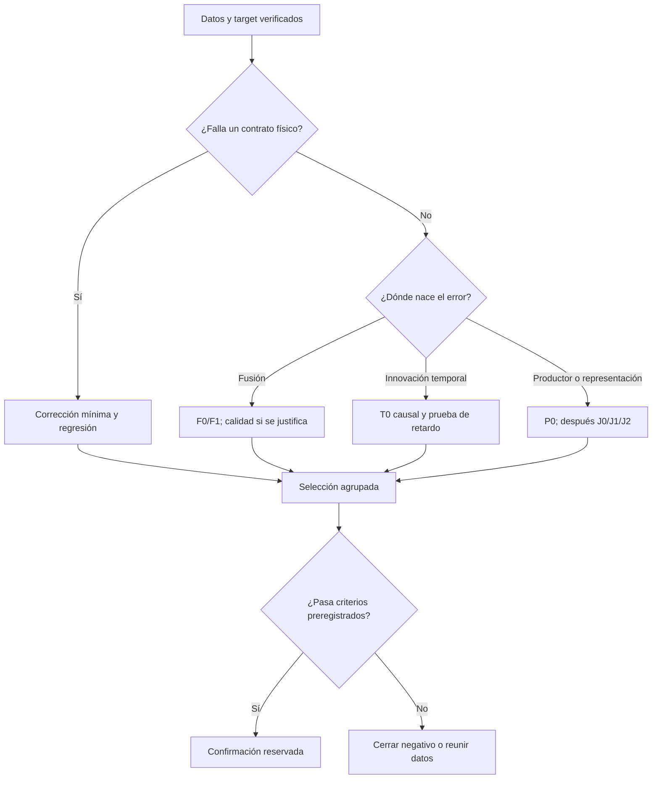

# 09 — Matriz experimental y reglas para decidir

## 1. Cómo usar esta matriz

Los experimentos se abren por una hipótesis y se cierran con un resultado interpretable. Una fase no se considera superada porque tenga muchos tests ni porque una curva parezca mejor. Los tests comprueban contratos; la evaluación independiente comprueba precisión.

Los identificadores siguientes son **propuestos para esta campaña**. No designan runs existentes. Cada ejecución tendrá su propia ficha basada en [EXPERIMENTO.md](plantillas/EXPERIMENTO.md), un hash de configuración y una entrada en el registro de intentos. Las versiones históricas V16/V18 y el candidato TRAIN40 mantienen su identidad.

## 2. Puertas de avance

| Puerta | Evidencia mínima | Qué permite |
|---|---|---|
| **G0 — Identidad y genealogía** | Código, pesos y normalizadores identificados; cadena de datos/selección de cada componente; incertidumbres explícitas | Reproducir el candidato con el alcance de procedencia que realmente esté demostrado. |
| **G1 — Datos y roles** | Solapamiento reproducido; grupos revisados; exclusiones; historial de exposición; roles sellados | Ejecutar desarrollo sobre grupos elegibles. No convierte datos históricos en test virgen. |
| **G2 — Evaluación** | Contrato de target y scoring de desarrollo, población y cobertura; fixtures físicos y numéricos | Medir candidatos en desarrollo. La equivalencia con el scorer oficial puede seguir pendiente, siempre separada. |
| **G3 — Diagnóstico** | Trazas y al menos una prueba discriminante por hipótesis prioritaria; conclusión y límites | Elegir una intervención que pueda ser refutada. |
| **G4 — Piloto** | Comparación controlada en selección; causalidad y cobertura conservadas; margen práctico preregistrado | Confirmar un candidato elegido, sin consultar el test expuesto para elegirlo. |
| **G5 — Confirmación** | Semillas cuando procedan, comparación pareada por grupos y evaluación reservada con exposición declarada | Publicar la mejora con el alcance que sostienen los datos; preparar evaluación externa. |

Si G0 no puede certificar ausencia de exposición, se conserva una etiqueta de procedencia desconocida. Eso no impide depurar lectura de sensores o realizar investigación exploratoria, pero sí impide afirmar transferencia limpia. Si G1 carece de Slider nuevo, la campaña puede demostrar resultados de carretera y fixtures; no se declara generalización real a Slider.

## 3. Experimentos de auditoría y diagnóstico

| ID | Pregunta | Cambio | Control | Resultado que cierra la tarea |
|---|---|---|---|---|
| D00 | ¿Se reproduce el solapamiento? | CLI de identidad, sin modelo | Mismos timestamps con imágenes diferentes; un píxel cambiado; fuente duplicada | Ocho correspondencias únicas y 365/365 frames; ambigüedad/ausencia explícitas. |
| D01 | ¿Qué pudo ver cada componente? | Grafo de procedencia | Componente sin manifest o normalizador sin scope | Relación componente→datos→roles→selección; los huecos no se rellenan por suposición. |
| D02 | ¿Qué es una unidad independiente? | Manifest agrupado y registro de exposición | Misma adquisición con otra cámara/alias | Ningún grupo cruza roles; se justifica el número real de grupos. |
| E00 | ¿Se compara el mismo TTC? | Evaluador y contrato | Clock desplazado, endpoint incorrecto, GT=0, etiqueta ausente | Fixtures pasan; diferencia entre diagnóstico local y score oficial visible. |
| E01 | ¿Qué baseline falla y dónde? | Reutilizar predicciones y ramas congeladas | Misma población y targets compatibles | Errores y cobertura por modelo; no confundir desacuerdo con verdad. |
| A00 | ¿En qué etapa nace el problema? | Trazas completas de productores/contextos/fusión | Predicción final con y sin instrumentación | Paridad final y ledger causal con variables aceptadas y rechazadas. |
| A01 | ¿La ROI empareja el mismo objeto? | Diagnóstico geométrico, sin ajuste a TTC | Escena sintética con extrínsecas conocidas; controles de profundidad | Error de proyección cuantificado o hipótesis no confirmada. |
| A02 | ¿La escala y referencia temporal son correctas? | Fixtures de movimiento y reloj | Traslación global de clock; reparametrización temporal físicamente consistente | Salidas transforman según lo esperado, o se localiza un contrato roto. |
| A03 | ¿El arranque causa una degradación específica? | Prefijos predefinidos de desarrollo | Historia madura frente a misma consulta con historia limitada | Curvas error/soporte por longitud, sin borrar consultas iniciales. |

Las inspecciones de las diez secuencias de competición se etiquetan `exposed_diagnostic`. Generan hipótesis y documentación de fallos. Sus errores no eligen ventanas, umbrales, arquitectura ni criterio de parada.

## 4. Experimentos de intervención

| ID | Hipótesis | Diseño mínimo | Solo abrir cuando | Comparación decisiva |
|---|---|---|---|---|
| B0/B1 | Un defecto concreto del adaptador explica parte del error | Original frente a una corrección, mismos pesos | Hay una regresión física que falla antes del cambio | Corrección pasa fixture y mejora desarrollo sin ocultar otros fallos. |
| T0 | La innovación temporal espuria limita precisión | Baseline frente a un estado causal con propagación física | A03/trazas muestran inestabilidad, con entradas correctas | Error, retardo, cambio de signo y respuesta a maniobras; no solo suavidad. |
| F0/F1 | La fusión necesita adaptación al dominio | Cabeza congelada frente a misma cabeza y mismas 20 entradas reajustadas | G0–G3 y datos de ajuste elegibles | Ganancia con capacidad constante y productores idénticos. |
| F2/Fcap | La calidad observable mejora la fusión | Calidad añadida frente a red de capacidad equivalente sin calidad | F1 y trazas justifican el mecanismo | Beneficio de la información, no solo más parámetros o más intentos. |
| P0 | El sesgo nace en un productor | Ajustar último bloque/cabeza del productor identificado | Fusión sola no puede recuperar la señal; existe soporte independiente suficiente | Productor mejora y downstream mejora sin perder el dominio fuente. |
| J0/J1/J2 | El aprendizaje predictivo está suprimiendo movimiento | Scratch supervisado / JEPA estándar / JEPA con objetivo dinámico, iguales datos y backbone | Probes muestran una limitación de representación y hay presupuesto | Mejor TTC agrupado y no solo menor pérdida latente o representación más bonita. |
| C00 | El ganador generaliza | Configuración bloqueada, semillas y reserva | Selección cerrada | Resultado externo o reservado con exposición declarada. |
| R00 | El modelo puede ejecutarse con menor coste | Optimizaciones que preserven semántica | Identidad y paridad definidas | p50/p95/p99, backlog y paridad; sin mezclar este objetivo con mejora de error. |

No hace falta ejecutar todas las filas. Si B1 resuelve el problema y confirma mejora, se puede cerrar una contribución de adaptación sin abrir J0/J1/J2. Si los datos no soportan una conclusión, ampliar la población puede aportar más que entrenar un modelo mayor.

## 5. Presupuesto de búsqueda

### Primera campaña

1. Ejecutar las auditorías D/E/A necesarias y un baseline congelado de desarrollo.
2. Elegir **una familia de intervención** según el diagnóstico.
3. Comparar el baseline con **hasta dos candidatos motivados**, con parámetros fijados antes de ver selección. F2/Fcap constituyen una fase posterior si F1 aporta una razón para abrirla.
4. Resolver un fallo de implementación no cuenta como una nueva hipótesis, pero se registra cada intento y sus salidas. Cambiar una pérdida, el rango de ventanas o el criterio de selección sí cuenta.
5. Si no hay señal, escribir el resultado negativo y decidir si la hipótesis queda descartada, falta potencia o falta información de entrada. No abrir diez variantes similares por inercia.

Este límite es una propuesta de control de sobreajuste y coste, no una propiedad óptima del problema. Ampliarlo exige registrar qué incertidumbre nueva lo justifica; no modificar retrospectivamente el registro anterior.

### Semillas y controles

El piloto puede usar semilla 7 para viabilidad. El candidato aprendido elegido se confirma con 7, 13 y 21; deben existir referencias emparejadas cuando se comparan dos procedimientos aprendidos. Si el baseline oficial es un checkpoint fijo, se distingue ese contraste de la comparación entre procedimientos de entrenamiento. Un filtro determinista no gana evidencia independiente por ejecutarse tres veces con distinta semilla.

En J0/J1/J2, separar dos preguntas: igualdad de datos/arquitectura para atribución y presupuesto total de cómputo para eficiencia. No llamar comparación de igual coste a un modelo que recibió mucho más preentrenamiento sin contabilizarlo.

## 6. Regla de selección

Antes del piloto, rellenar:

```yaml
# PROPUESTA DE CONTRATO; no es una configuración ya implementada.
primary_population: eligible_development_groups
primary_metric: macro_relative_absolute_error
unit_of_resampling: acquisition_group
full_population_coverage_required: true
selection_source: group_validation_only
practical_improvement_margin: TO_BE_SET_BEFORE_SELECTION
source_domain_regression_margin: TO_BE_SET_BEFORE_SELECTION
critical_range_regression_margin: TO_BE_SET_BEFORE_SELECTION
latency_budget: TO_BE_SET_FROM_MEASURED_USE_CASE
tie_break: simpler_model_then_lower_measured_cost
```

Los márgenes se fijan usando requisitos de uso, escala de ruido de los targets y variabilidad basal de desarrollo. No se propone un «5 %» como ley universal. Si aún no se puede justificar un margen práctico, se reportan diferencias e incertidumbre y el piloto se mantiene exploratorio.

La promoción requiere que la métrica primaria mejore, la cobertura no caiga, los contratos se conserven y las regresiones de las poblaciones de protección estén dentro de los márgenes declarados. Una mejora macro con colapso de negativos, TTC corto o una familia esencial se conserva como tradeoff, no como ganador universal.

## 7. Árbol de decisión



La elección de rama depende de evidencia, no del atractivo de una arquitectura reciente.

## 8. Criterios de parada

- **Integridad:** identidad inconsistente, mezcla de grupos, futuro en entradas o target filtrado a inferencia → detener esa ejecución y conservar evidencias.
- **Información insuficiente:** no hay datos independientes del dominio que se quiere afirmar → limitar el claim y abrir adquisición de datos.
- **Hipótesis negativa:** el control adecuado no mejora → documentar y cerrar esa rama.
- **Incertidumbre estadística:** diferencia pequeña con pocos grupos → resultado inconcluso, sin ampliar seeds para simular más población.
- **Coste:** el piloto supera el presupuesto que se fijó tras medir throughput → reducir alcance o reevaluar su valor antes de escalar.
- **Éxito:** candidato confirmado en el alcance declarado → producir release reproducible y evaluación externa; las nuevas ideas pueden ir a otra campaña.

Fuentes del diseño: [plan original](https://github.com/Kripta-Studios/phase-ttc/blob/30b28b5c14eb9ed60067ed2f1dc262d7b60f2654/docs/superpowers/plans/2026-10-30-evttc-transfer-diagnosis.md), [contrato de adaptador](https://github.com/Kripta-Studios/phase-ttc/blob/30b28b5c14eb9ed60067ed2f1dc262d7b60f2654/docs/decisions/ADR-0043-evttc-competition-sensor-adapter.md), y razonamiento experimental de esta revisión. Los gates y la matriz son propuestas nuevas.
