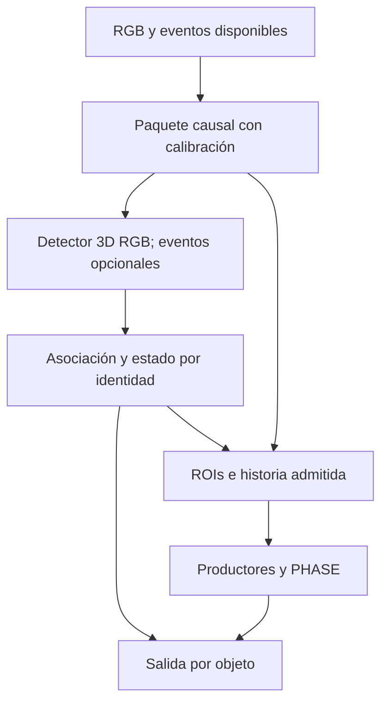
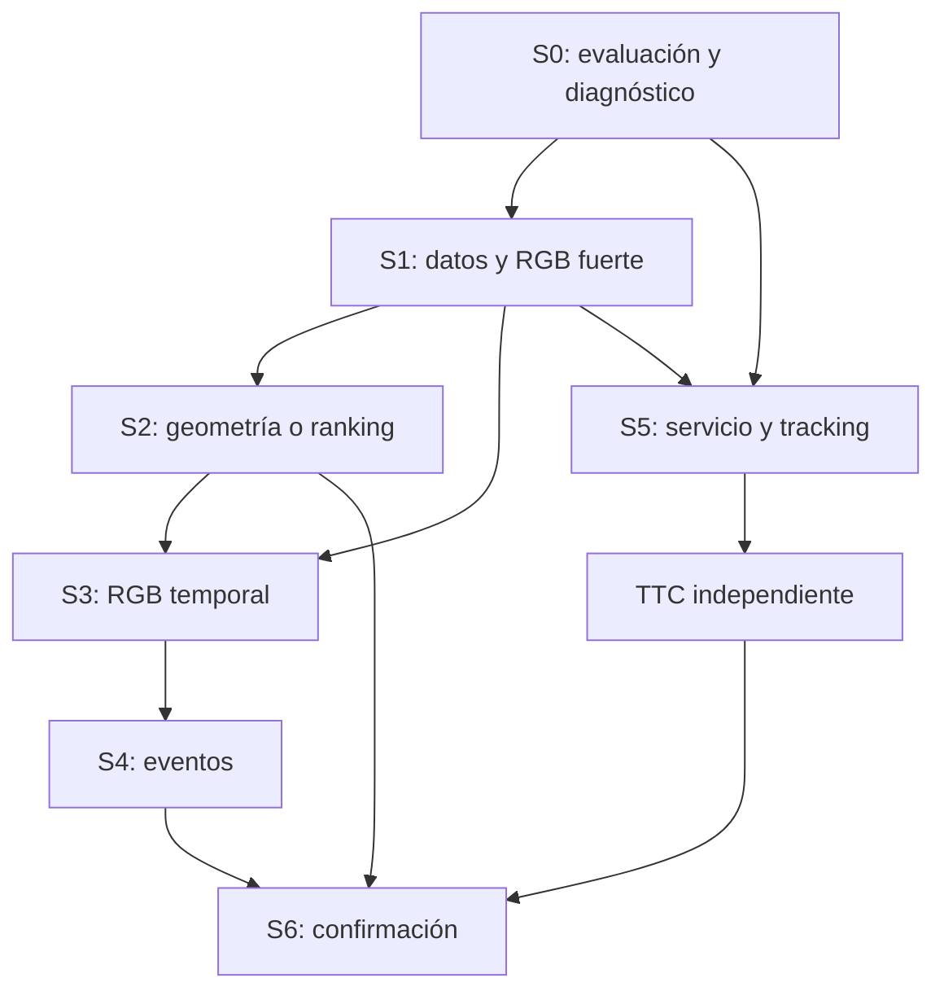

# PHASE-TTC: plan de continuación hacia un resultado competitivo y una evaluación SOTA defendible

**Fecha de revisión:** 29 de octubre de 2026.\
**Alcance de esta entrega:** planificación, inspección de código y fuentes, y auditoría CPU de metadatos/recibos. No se ha entrenado, ejecutado inferencia GPU, enviado una submission ni publicado cambios.\
**Base del plan:** `dev/eap-detection-local-20261029`, commit **`24b8f36f6e4aa17c965f9526d8cf486b512a8046`**. Incluye los resultados incorporados en `5c9fc73062f109f808be732a4a10d6f26a91afee`; el piloto se ejecutó sobre `3ebac039e56e3e5af98e0e3302084f00923235a1` y su snapshot de fuentes. `origin/main` inspeccionado: `f2903f0bfd47d7bf56358a94ad5fac0b8a8906ef`. No confundir estos tres estados.

Se trabajó en un worktree aislado, rama local `analysis/eap-sota-20261029`, sin modificar archivos del repositorio. Este documento es una continuación separada: preserva los informes, pesos y resultados históricos, el artículo y el namespace `e_jepa_ttc`.

## 0. Decisión central

**Mantener MonoDGP portable, corregir primero el contrato de evaluación, ampliar la diversidad de datos y construir un baseline RGB con curvas de validación. Después incorporar mejoras geométricas o de ranking según el error observado; a continuación, historia RGB causal, eventos y evaluación multiobjeto con PHASE.** Compartir backbone o hacer entrenamiento multitarea queda condicionado a que las ramas separadas demuestren utilidad.

El piloto prueba que la ruta técnica puede ejecutarse. No permite identificar todavía qué limita más la AP, ni cuánto entrenamiento resolverá el problema. Tampoco permite prometer SOTA. Este plan convierte esa aspiración en comparaciones concretas, experimentos falsables y decisiones de avance.

La primera inversión no debe ser una campaña larga: hay una dependencia del GT de evaluación respecto del adaptador de entrenamiento, faltan diagnósticos de ranking y la clase más rara mantiene muy pocas identidades incluso al ampliar el split. Estos factores pueden cambiar la interpretación de cualquier mejora.

### Convenciones de evidencia

| Marca | Significado |
|---|---|
| **V** | Verificado ahora en código, metadatos o recibos publicados; se indica si es una recomputación o solo inspección del recibo. |
| **P** | Decisión propuesta para implementar después; no existe por aparecer en este documento. |
| **H** | Hipótesis que un experimento debe confirmar o descartar. |
| **B** | Bloqueo o dato pendiente que limita una ejecución o una afirmación concreta. |

Las cifras históricas conservan su población y protocolo. Un nuevo perfil de evaluación tendrá otro identificador; nunca se sustituirán silenciosamente los resultados del piloto.

## 1. Qué significa aquí «conseguir SOTA»

Se deben separar cuatro objetivos y sus pruebas:

| Objetivo | Evidencia necesaria | Estado actual |
|---|---|---|
| Superar el piloto de detección | Mismas imágenes, GT, protocolo y controles; curva y mejora reproducible | Posible como desarrollo, tras versionar la evaluación |
| Competir en detección 3D eAP | Release y clases exactas, scorer, restricciones de sensores/preentrenamiento, referencia vigente y evaluación comparable | **B:** scorer y leaderboard vigente no verificados |
| Mejorar el sistema detector–tracking–TTC | Población fijada, entradas predichas, historia causal, GT TTC alineado y productores independientes del conjunto evaluado | **B:** el ejemplo actual no mide esta generalización |
| Buen compromiso precisión/recursos | Métricas y latencia integral, RAM/VRAM, número de objetos y tasa de abstención en el mismo equipo | Solo perfiles parciales del piloto |

El artículo eAP publica en su Tabla IV resultados de **Car**, no una clasificación actual de ocho clases: RGB de un frame obtiene AP 0,510/0,403 en Driving/HDR; RGB+eventos de un frame, 0,515/0,460; con tres frames, 0,531/0,558. Sirven como comparadores publicados bajo su protocolo. **No se deben dividir esas cifras por 0,02064 para estimar la distancia a SOTA.** [E1]

El proyecto/paper describe 46 secuencias train, mientras la revisión HF fijada utilizada en el proyecto contiene 40. Hay que reconciliar release, splits y disponibilidad antes de una reproducción comparable. La inspección del repositorio oficial no localizó un scorer ejecutable ni el entrenamiento completo de ese baseline. Los accesos públicos a CodaBench consultados no devolvieron una clasificación/protocolo verificable; esto no prueba que el benchmark haya desaparecido. [E2][E3]

**P:** crear `BENCHMARK_TARGET.md` con fecha, tarea, release, sensores permitidos, métricas, política temporal, datos externos, restricciones de preentrenamiento y referencia a superar. Si el protocolo oficial sigue inaccesible, continuar con métricas de desarrollo y una comparación local reproducida; la afirmación de SOTA oficial sigue bloqueada. No contactar a organizadores ni enviar resultados en esta iteración.

## 2. Auditoría del punto de partida

### 2.1. Qué está demostrado y qué se reutiliza

**V, recibos y código:** el detector completo, ocho logits de clase, geometría 3D y cabeza de dos componentes de velocidad funcionan en la variante portable. El piloto registra 512 actualizaciones, 2.048 exposiciones y 18,28 minutos de entrenamiento. La inferencia independiente registra 279 frames y paridad exacta en 272 comparados, incluida velocidad. La cifra de 232 pruebas se verificó en el XML ligado por hash; **no se repitieron aquí esas 232 pruebas ni el entrenamiento GPU**. Se comprobaron 49 hashes de fuentes y la regeneración exacta de las tablas. [R1][R2][R3]

Se reutilizan:

- La separación del entorno detector respecto de PHASE, el lock y los hashes de fuentes/pesos.
- El lector eAP, el adaptador geométrico y los fixtures contrastados con el visualizador oficial, dentro de su alcance admitido.
- El operador deformable portable y el modelo que ya aprendió en la GPU local; no se presupone equivalencia con el kernel CUDA externo.
- El manifest del piloto, las curvas, controles constante/permutado y la inferencia sin etiquetas.
- Los productores, pesos y runtimes existentes de PHASE, conservando su procedencia y exposición TRAIN40.
- El servicio `operational/train40_runtime/multiobject.py` como base posterior de ejecución; el bridge actual utiliza otro runtime y no demuestra su integración completa.

**V:** el backbone es ResNet-50 ImageNet1K V1, con stem/layer1 congelados, layer2–4 entrenables y FrozenBatchNorm. El runner emplea AdamW con LR global `2e-4`, decay `1e-4`, clip `1`, sin scheduler ni augmentation adicional al resize/normalización. La cabeza ya soporta ocho clases. Añadir más logits no resolvería la ausencia de positivos. [R4][R5]

**V, recomputación de la curva:** la pérdida media por pasada bajó de 62,36 a 25,70; la pérdida de centro, de 0,08136 a 0,02539. Solo se dispone de AP final. Los 512 gradnorms preclip excedieron uno, con mediana 70,49. Esto justifica instrumentación; no demuestra explosión de gradientes, convergencia ni que convenga eliminar clipping. [A1]

### 2.2. Primer problema: población evaluada ligada a targets entrenables

`prepare_sample()` construye `native_ground_truth` después de filtrar targets; `evaluate()` utiliza esa lista como GT. Se reprodujeron los filtros sobre los 512 frames del piloto mediante etiquetas y calibración, sin leer píxeles ni ejecutar el modelo. [R4][R5][A2]

| Población del piloto | Anotaciones raw | Admitidas | Fuera de profundidad `[0,1;60)` m | Centro fuera de imagen | Otras exclusiones |
|---|---:|---:|---:|---:|---:|
| Train | 1.565 | 829 | 635 | 98 | 3 |
| Selección | 1.936 | 938 | 901 | 92 | 5 |

Selección retiene el **48,45 %** de las anotaciones raw. El decoder no aplica el mismo máximo de profundidad/FOV a sus predicciones y el evaluador no incorpora regiones ignoradas equivalentes. Una predicción de un objeto excluido puede convertirse en FP local. No se puede asignar una dirección universal al sesgo ni solucionarlo descartando cómodamente más GT.

**P:** separar tres objetos de datos: `TrainingTargets`, `EvaluationGroundTruth` e `IgnoredGroundTruth`. La elegibilidad evaluable proviene de la tarea, común a todos los modelos, no de las limitaciones de MonoDGP. Mantener `legacy_pilot_v1` y crear un perfil nuevo; no comparar sus números directamente. El universo raw completo será un diagnóstico de cobertura, no automáticamente una tarea monocular justa si incluye objetos fuera del campo visual.

### 2.3. Qué representa realmente AP 0,02064

**V:** es AP101 de desarrollo, matching por clase y centro XY a distancias estrictamente menores de 0,5/1/2/4 m, con macro sobre las cinco clases que tienen GT admitido. No replica necesariamente las reglas nuScenes/eAP sobre mínimos de recall/precision, rangos, clases, yaw o ignorados. [R6]

| Clase en selección | GT admitido | AP local |
|---|---:|---:|
| car | 721 | 0,08338670 |
| truck | 205 | 0,01973244 |
| motorcycle | 6 | 0,00008441 |
| pedestrian | 2 | 0 |
| bus | 4 | 0 |
| bicycle, tricycle, other_vehicle | 0 | Sin soporte para medir AP |

El agregado con ocho clases y cero explícito en las ausentes es 0,01290044; es una convención, no evidencia observada de ocho clases. La AP train promedia siete clases: su diferencia frente a selección no es por sí sola un gap limpio de generalización. [R1][A2]

A 2 m hay 401 matches entre 938 GT admitidos y 12.800 propuestas: recall 42,75 % y precisión 3,13 % a ese punto sin umbral de score. **No son AP**, ni permiten atribuir los no-matches a duplicados. Las colas de scores bajos pueden no cambiar la envolvente de AP. Una transformación estrictamente monótona por clase, con pool/cajas/clases fijos, conserva el ranking y la AP; sirve para calibración operacional, no como mejora automática del detector.

### 2.4. El soporte raro continúa siendo un límite al ampliar datos

**V, auditoría nueva de metadatos:** se verificaron los hashes de las cuarenta etiquetas train de HF en revisión `a814a946e60d37f7242358af5f344542177e50c5`. No se leyeron etiquetas Test12. El split candidato 24/8/8 contiene las ocho clases raw en todos los roles. [A2][A3]

| Clase | Anotaciones raw train24 | Selección8 | Calibración8 |
|---|---:|---:|---:|
| car | 304.200 | 90.884 | 101.200 |
| truck | 107.686 | 38.670 | 33.085 |
| motorcycle | 22.732 | 39.555 | 18.710 |
| pedestrian | 7.808 | 14.415 | 7.154 |
| bus | 5.137 | 3.335 | 1.738 |
| tricycle | 2.268 | 2.668 | 623 |
| bicycle | 834 | 789 | 446 |
| other_vehicle | 237 | 153 | 183 |

Aplicando las fórmulas actuales de admisión y la resolución original documentada 1280×720, sin certificar medios ni la población oficial:

| Rol | bicycle: anotaciones / IDs admitidos | other_vehicle: anotaciones / IDs admitidos |
|---|---:|---:|
| Train24 | 655 / 69 | **53 / 6** |
| Selección8 | 596 / 65 | **60 / 5** |
| Calibración8 | 270 / 26 | **51 / 4** |

Un ID es el par anotado `(sequence_id, track_id)`, no una prueba de objeto físico o adquisición independiente. Repetir seis IDs no produce seis centenares de objetos nuevos. La expansión mejora soporte, pero no autoriza afirmar robustez de `other_vehicle`.

### 2.5. Geometría, velocidad y puente: alcance exacto

**V, recibo previo inspeccionado:** hay correspondencia original↔HF exacta para 17.611 filas de una secuencia train, comparación con el visualizador y tres overlays reales. Esto sustituye el bloqueo anterior de la ruta RGB por el gate acotado `G0_RGB_BOX_V1`; no certifica el scorer. Se conservan centro geométrico, ejes ego X delante/Y izquierda/Z arriba, caja original `[x,y,z,l,h,w,yaw]`, `size` HF `[w,l,h]`, transformación `p_event=T_event_ego·p_ego` y giro original `Rz(-yaw)` sobre largo local en Y. La conversión estándar del rumbo sería `pi/2-yaw`; no se impone al submission sin verificación. [R7]

La velocidad se entrena contra dos componentes publicados. Su mejora L2 está condicionada a 401 matches de tres clases; falta cerrar marco/referencia/construcción física. No introducir `TTC=-Z/v` como restricción ni denominarla AVE oficial. [R1][R8]

**V, código del bridge:** el ejemplo selecciona una detección de mayor score, usa siete frames y asociación greedy con el frame previo; carga `CompetitionRuntime`, no `MultiObjectTrain40Service`. No conserva un estado `lost` para reaparición. Se reprodujo una ambigüedad inversa que puede heredar un ID por orden sin marcar ambigüedad. Es una limitación del alcance de la demo, no una refutación de que el replay funcione. [R9][A2]

La salida TTC no tiene GT alineado y usa secuencias expuestas a TRAIN40. El score de detección, calidad de asociación, TTC firmado y q10/q90 de fase son conceptos distintos. No hay nueva precisión TTC ni cobertura calibrada demostradas. [R1][R9]

## 3. Estado del arte: selección de ideas y controles

La selección siguiente se basa en fuentes de autores/papers consultadas al 29-10-2026. Es una lista priorizada de comparadores e ideas pertinentes, no una certificación del líder mundial vigente en cada benchmark.

| Método | Qué aporta y disponibilidad comprobada | Papel propuesto y condición |
|---|---|---|
| MonoDGP portable actual | Implementación local ejecutada con datos eAP y ocho logits | Baseline principal; preservar contratos y pesos iniciales para ablations |
| MonoDETR | Control de la familia de detectores con profundidad y transformer; fuente fijada disponible | Un control bajo igual contrato/población/presupuesto, tras la receta RGB; no otro port simultáneo por defecto [E4] |
| **SPAN, CVPR 2026** | Alineamiento espacial de corners y proyección, pérdidas progresivas; implementación basada en MonoDGP, código y pesos publicados | Primera idea geométrica a aislar si los residuos de proyección/tamaño dominan. Adaptar a ejes y visibilidad eAP, sin copiar su stack antiguo [E5] |
| **RARE, CVPR 2026** | Aprendizaje de ranking de calidad relativa y selección entre hipótesis; código publicado | Si existen propuestas buenas mal ordenadas. Diseñar el target de calidad para la métrica eAP; no asumir que KITTI IoU es su objetivo exacto [E6] |
| **MonoCoP, CVPR 2026** | Cadena de predicciones geométricas y selección con incertidumbre; código, logs y pesos publicados | Alternativa completa si el baseline y las correcciones acotadas se estancan; nueva admisión de entorno y presupuesto [E7] |
| ImVoxelNet / baseline eAP | Representación voxel/BEV como referencia relacionada con el paper eAP | Comparador con datos/calibración/protocolo y coste admitidos; las poses de ego-movimiento son un requisito adicional de la fusión BEV temporal, no del control de un frame [E1][E8] |
| MAGneT-3D, ECCVW 2026 DriveX | Referencia temporal para detección monocular, identidad y generalización de dominio | Estudiar memoria/queries; el stack y coste publicados no se presuponen compatibles con la GPU local [E9] |
| MonoIA, CVPR 2026 | Modelado del cambio de intrínsecos con representaciones de intrínsecos | Prioridad baja con una configuración de cámara; reconsiderar si hay transferencia entre cámaras/datasets [E10] |

**P:** la primera ronda moderna será una intervención en el MonoDGP que ya funciona. Se elige SPAN-like o ranking-like según el diagnóstico; no se suman ambas y un backbone nuevo en el primer experimento. Importar ideas requiere nuevas pruebas de geometría y pérdidas; no basta cambiar el nombre del modelo.

**H de investigación posterior:** fusión causal RGB–eventos cuya contribución dependa de calidad observable, con historia coherente por objeto, puede aportar más que acumular módulos sobre una detección monocular débil. No se afirma novedad ni ventaja hasta comparar con RGB temporal, capacidad adicional equivalente y controles de eventos.

## 4. Arquitectura y contratos que deben estabilizarse

La ruta objetivo sigue siendo detector 3D → asociación causal → preparación de ROIs/historia → PHASE. El sensor de eventos puede alimentar después el detector y ya alimenta la preparación PHASE; no obliga a compartir encoders.



**P, interfaces nuevas/versionadas:**

| Contrato | Campos mínimos y responsabilidades |
|---|---|
| `SensorPacket` | `sequence_id`, token, timestamp de exposición inicio/fin, reloj/unidad, timestamp de llegada si medido, cutoff de eventos, calibración/hash, RGB transformado y mapa de transformaciones. La llegada desconocida se representa como desconocida. |
| `Detection3D` | Token, `query_id`, ocho scores/logits en sidecar, clase, centro ego, dimensiones semánticas `lwh`, yaw con `yaw_convention`, score de detección, velocidad con frame/semántica declarada o estado pendiente, validez, box2D y geometría de proyección. |
| `TrackObservation` | `track_id`, `generation`, asignación y margen, estado `tentative/confirmed/lost/closed`, medición versus predicción, edad, timestamps, incertidumbre de movimiento y razones de abstención. |
| `ObjectHistory` | Solo observaciones disponibles antes de la decisión, máscara de historia, ROI por observación y ROI común cuando la preparación PHASE lo requiera, fuente de ROI, huecos/oclusiones, versión/calibración, leases/caches por generación. |
| `JointPrediction` | Detección y track siempre conservados; `ttc_status`, `ttc_signed_s` nullable, fase y q10/q90 originales, `phase_calibration_status`, clocks de salida, procedencia de checkpoint/protocolo. |

No exigir una matriz de covarianza inventada a un detector que no la predice. Registrar qué incertidumbre es aprendida, estimada o desconocida. Las cabezas existentes no pasan a estar calibradas por renombrar un campo.

Las features requeridas por PHASE y su preparación actual mantienen su ABI: introducir embeddings del nuevo detector no equivale a suministrar los productores que esperan los pesos históricos. Cada cambio de productor, normalización, crop o historia exige versión y evaluación de distribución. `e_jepa_ttc` permanece como namespace; un adapter en `operational/` conecta el servicio sin reescribir los resultados publicados.

## 5. Fase S0: protocolo y diagnóstico, antes de ampliar entrenamiento

### S0.1. Congelar la procedencia y desacoplar la evaluación

**P, tareas:**

1. Registrar commit, snapshot ejecutado, hashes de checkpoint/manifest/calibración y entorno. Conservar originales; toda salida nueva usa un directorio nuevo.
2. Crear un `EvaluationProtocol` con versión y hash: release, clases, unidades/ejes, elegibilidad GT, ignorados, filtros de predicciones, matching, distancias, interpolación AP, tratamiento de clases sin soporte y número máximo de propuestas.
3. Mantener el evaluador histórico para reproducción. El nuevo generador de GT no importa `prepare_sample()` ni recibe parámetros de capacidad del detector. Conectarlo tanto al analizador externo como a la validación interna y selección de checkpoints del runner; probar que esta última usa `EvaluationGroundTruth` v2 y que la cifra legacy se calcula por una ruta separada.
4. Resolver dominio visible/rango con la especificación disponible y documentar decisiones provisionales. Una caja difícil válida no desaparece porque el entrenamiento actual la rechace. Un GT fuera de dominio no se convierte automáticamente en negativo; las reglas de ignorados se fijan antes de los resultados.
5. Cuando exista scorer verificable, fijar revisión y fixtures de paridad. No modificarlo para que coincida con las métricas locales.

**Pruebas de aceptación:** predicción perfecta, caja de dimensión desigual y yaw conocido, distancia exactamente en el umbral, predicción fuera de dominio, GT ignorado frente a ausente, duplicados, clase sin soporte, Z equivocada con XY correcto y límite de propuestas. La misma lista/hash de GT debe alimentar todos los modelos. Un caso perfecto sobre GT elegible no debe producir FP por una regla de admisión del entrenamiento.

### S0.2. Diagnosticar el checkpoint fijo

El checkpoint publicado tiene SHA-256 `dc0ce304ad1c8a791ef66395be85b09f22526bc11a834472dcb18ce16384e338`; sus tensores y las predicciones completas permanecen en el ordenador local del usuario. Esta revisión no los tuvo disponibles. [R2]

**P:** añadir un sidecar opcional por query con logits, clase, box2D, centro UV, dimensiones, `depth`, componente de incertidumbre, prior geométrico y residual cuando sean reconstruibles, yaw/alpha, velocidad y causas de rechazo. La salida normal debe permanecer idéntica con el sidecar activado/desactivado. Volver a inferir sin abrir etiquetas; evaluarlas en un proceso separado.

**Restricción de implementación verificada en revisión:** la inferencia histórica carga sus módulos/decoder desde el snapshot del checkpoint y valida sus hashes. Editar el adaptador actual no modifica libremente ese productor. Para el diagnóstico histórico, implementar un **observador externo de outputs** en el lanzador o un nuevo `diagnostic_export.py`; conservar intactos pesos, snapshot, preregistración, módulos y decode originales, y registrar el hash del observador por separado. Un componente interno que no pueda obtenerse de las salidas originales se marca no disponible; no se relajan hashes para capturarlo. Probar inferencia con el snapshot antiguo y rechazo ante su corrupción. Las instrumentaciones internas de modelos futuros se versionan como nuevos productores.

Medir sobre selección de desarrollo congelada:

- Recall class-agnostic y por clase a K fijo; confusión, FN, duplicados y errores de fondo, distribuidos por secuencia, distancia, tamaño y truncación.
- Errores XY y Z por separado, dimensiones por componente y clase, yaw circular, reproyección y métricas 3D diagnósticas. El matching XY actual puede ocultar Z deficiente.
- Curvas PR, score frente a calidad geométrica y diagnóstico de incertidumbre. Probar el decoder actual una clase/query frente a topK de `Q×C` con igual presupuesto, sin interpretar scores duplicados como detecciones independientes.
- Oráculos de desarrollo: fijar el pool de propuestas y la regla de correspondencia con GT para construir cada sustitución de clase, centro/profundidad, dimensiones/yaw o ranking. Volver a ejecutar después el matching del evaluador sobre las predicciones transformadas si se informa AP; no reutilizar un matching obsoleto como si fuera la métrica. Son diagnósticos con GT, nunca predicciones del sistema ni resultados para test.
- Residuo `z_GT - fy·H_GT/h_box` por clase/yaw/rango/truncación, usando caja completa y recortada. Ver si una máscara de foreground excluye objetos visibles y les asigna fondo. No declarar un error de orden de dimensiones sin evidencia.

**Decisiones:** bajo recall incluso con clase correcta → propuestas/escala/datos; buenas propuestas mal ordenadas → ranking; errores altos de tamaño/profundidad/proyección → geometría y supervisión; fallo concentrado en raras → diversidad y muestreo. NMS, umbrales o temperatura se evalúan como controles adecuados a su función, sin prometer una mejora automática de AP.

**Gate S0:** protocolo v2 fijado y testeado, GT independiente del modelo, denominadores completos, diagnóstico reproducible del checkpoint en la máquina que lo conserva. El acceso al scorer limita la afirmación oficial, pero no impide ejecutar desarrollo bajo un perfil explícito.

## 6. Fase S1: datos y baseline RGB suficientemente fuerte

### S1.1. Separación por grupos y control de exposición

**V:** el piloto real entrenó con `qGsgzl4Q8B` y `nRcwUlHyAd`; seleccionó sobre `JaGC4Q9pgU` y `2Y46OkK3ff`. Estas dos últimas ya son desarrollo expuesto y no pueden convertirse en un holdout virgen. [A2]

**P:** mantener provisionalmente los roles de 24 train y ocho selección, y estudiar dividir las ocho secuencias antes reservadas para calibración en cuatro de calibración y cuatro de auditoría final. Antes de asignar:

1. Recuperar agrupación de adquisiciones, rutas/sesiones relacionadas, timestamps y duplicados visuales. No dar independencia por demostrada solo porque cambia `sequence_id`.
2. Auditar exposición histórica de cada productor, incluidos preentrenamiento autosupervisado, teachers, normalización y selección previa. «No usado por el detector del piloto» no significa «nunca usado por PHASE».
3. Contar soporte evaluable bajo el nuevo contrato por clase, grupo e identidad. Dentro de las ocho secuencias de calibración actuales, solo `2JkLL5W891` y `rhYxPcU29n` aportan `other_vehicle` admitido por el perfil antiguo. No repartirlas mecánicamente sin verificar si son adquisiciones distintas.
4. Fijar la asignación por grupos y cobertura antes de ejecutar candidatos, conservando el split histórico. Si grupos relacionados cruzan los roles propuestos, resolverlo antes del nuevo experimento, sin desplazar selección expuesta a auditoría.

El esquema **24/8/4/4 es una propuesta condicionada**, no un split ya aprobado. La calibración rara con cuatro IDs en el conjunto original no respalda garantías por clase. Si se adopta, versionar también la admisión: el esquema v1 solo acepta `train/selection/calibration`; v2 debe reconocer `audit` explícitamente y sus prohibiciones, preservando v1. No eludir el guard ni renombrar auditoría como calibración. Si no hay grupos/soporte suficientes, mantener 24/8/8 y declarar que falta una confirmación local independiente; reservar una eventual evaluación oficial para el checkpoint congelado. No llamar al mismo conjunto «calibración» y «auditoría independiente».

Tras abrir auditoría, cualquier decisión de rediseño la convierte en desarrollo. Un refit posterior con las cuarenta secuencias consume el holdout local, cambia el productor y no hereda automáticamente su calibración. Test12 permanece excluido de entrenamiento, elección de modelos, normalización, pseudoetiquetado y ajuste de umbrales.

### S1.2. Construir cobertura y diversidad, no solo más exposiciones

**P:** generar un manifest que registre por frame/grupo: clases raw/evaluables/entrenables, rango, tamaño en píxeles, oclusión/truncación si están disponibles o se anotan para auditoría, condiciones de iluminación y número de objetos frente a la capacidad de queries. Registrar negativos reales y causas de exclusión.

Los metadatos existentes señalan candidatos train concretos para cubrir cola: `Po6ePjWYAz` contiene 19 anotaciones `other_vehicle` y 187 de bicicleta admitidas; `8SdieOgbva`, 12 y 46; `nRcwUlHyAd`, 15 y 46; `9ITOs4twfk`, cuatro `other_vehicle`; `t79dBxj1WS`, tres. Son criterios de cobertura train, no selección por predicciones. Hay que revalidarlos con el nuevo perfil y con medios disponibles. [A2]

Proponer una escalera de datos:

- **D4096:** hasta 4.096 frames únicos de los grupos train admitidos, con cobertura temporal por secuencia y presencia de todas las identidades raras disponibles. Si hay incompatibilidad entre tamaño, cobertura y grupos, se registra y se aumenta el manifest antes del run. No duplicar frames para fingir diversidad.
- **D16384:** hasta 16.384 frames únicos, conservando reglas de muestreo y cobertura; comparar la curva de cantidad de datos bajo la receta elegida.
- **Dfull:** todos los frames train que admita el protocolo, o un stride temporal explícito fijado por coste/correlación. Conservar por separado densidad temporal para experimentos de historia.

Son presupuestos de diseño, no cantidades óptimas demostradas. Las selecciones de evaluación mantienen una distribución y denominador fijos; un panel enriquecido con casos raros sirve como diagnóstico separado, no reemplaza la prevalencia natural del conjunto completo.

Para clases escasas, revisar taxonomía y errores de etiqueta con una muestra train preregistrada. Versionar cualquier corrección sin sobrescribir originales. Si sigue habiendo solo unos pocos objetos independientes, buscar **más datos train públicos o anotaciones nuevas autorizadas**, verificar derechos, taxonomía, geometría y solapamiento. La diferencia 40/46 no autoriza tratar las seis secuencias restantes como disponibles, limpias o compatibles. Pseudoetiquetas, oversampling y datos sintéticos son experimentos separados; no sustituyen evidencia real en evaluación.

### S1.3. Entrenador reproducible y lectura con memoria acotada

**P, cambios previos a una campaña:**

- Configuración declarativa de arquitectura, datos, augmentations, pérdidas, grupos de parámetros, precisión y presupuesto. Extender `build_detector()` de `scripts/smoke_monodgp_portable.py`: hoy su interfaz no recibe todos los campos que propone este plan y lee el YAML upstream. Para nuevos runs, validar y aplicar una configuración completa; rechazar opciones desconocidas o ignoradas; registrar el modelo efectivo y su hash. Mantener la construcción histórica para sus checkpoints.
- Ledger de parámetros congelados/entrenables y LR efectivo. Registrar pérdidas y gradientes por cabeza, norma pre/postclip y ratio de actualización respecto al peso.
- Checkpoints `last` y seleccionados con hashes, optimizer, scheduler, RNG, scaler si se usa y posición del sampler. Probar que resume conserva orden/estado; no prometer igualdad bit a bit del backward CUDA.
- Validación periódica con población congelada y criterio de selección preregistrado; guardar curvas, predicciones y denominadores además de escalares.
- Perfil de lectura, decodificación, preparación, transferencia, forward, pérdidas, backward, update, evaluación y guardado. Medir RAM, memoria Torch asignada/reservada y VRAM total del proceso cuando sea posible. Actualizar `profile_monodgp_stages.py` para restaurar variante/configuración y batch reales: el profiler histórico usa `predict_velocity=False` y targets sin velocidad, por lo que no admite sin cambios el checkpoint de velocidad del piloto. Conservar su perfil anterior como evidencia válida de aquella variante.
- Indexado y prefetch acotado del lector. La caché actual de 32 muestras preparadas, dos shards/dos secuencias y preparación síncrona puede degradarse al ampliar datos. Elegir workers/prefetch mediante perfil; no cargar todo ni duplicar tablas completas por worker.

**Aceptación:** equivalencia de tokens, píxeles y targets entre lector original/optimizado en fixtures; cero solapamiento de roles; gradientes y pérdidas finitos; roundtrip configuración→modelo→checkpoint→inferencia/profiler con carga estricta y variante de velocidad correcta; estado del sampler recuperado; recursos medidos sin paginación sostenida en el perfil de admisión. No se cambia la preparación para ganar velocidad sin verificar su efecto.

### S1.4. Matriz de optimización inicial

Conservar R50, ocho clases, 50 queries, 11 grupos y el backend portable en la primera comparación. Inicializar desde el mismo archivo ImageNet verificado; no mezclar un candidato entrenado desde cero con otro calentado en el piloto sin declarar esa diferencia.

**P, screening de receta:** D4096, semilla 7, batch efectivo cuatro, FP32 y presupuesto inicial de ocho pasadas efectivas. Con 4.096 frames exactamente serían 32.768 exposiciones y 8.192 updates. Registrar la cifra real si el manifest difiere. Es un límite de experimento propuesto, no una estimación de duración ni un entrenamiento suficiente para SOTA.

| ID | Cambio respecto al control indicado | Pregunta |
|---|---|---|
| RGB-R0 | Receta actual en D4096 | ¿Cuánto mejora solo la cobertura? |
| RGB-R1 | R0 + warmup 5 % de updates y cosine hasta 0,05×LR | ¿La evolución del LR mejora la optimización? |
| RGB-R2 | R1 + LR backbone 0,1×LR de cabezas | ¿Conservar mejor las features ImageNet ayuda? |
| RGB-R3 | Mejor R1/R2 + augmentation fotométrica moderada | ¿Mejora la generalización de iluminación? |
| RGB-R4 | R3 + muestreo de clases raras limitado por identidad | ¿La cola mejora sin degradar los comunes? |
| RGB-R5, condicional | Mejor receta + 960×576, tras perfil y auditoría K | ¿La escala de objetos limita recall/calidad? |

Warmup/LR diferencial son **propuestas**, no recuperación exacta de MonoDGP: el upstream inspeccionado no usaba warmup ni LR diferencial. Los valores concretos de esta tabla son puntos de partida declarados, no hiperparámetros ya validados. Cambiar exclusión de biases del decay, clipping o pérdidas requiere otra ablation y su registro. No introducir todas esas diferencias dentro de R1 sin declararlas. [A1][E11]

Para R4, proponer mezcla de muestreo uniforme y repetición de frames raros con un tope inicial de cuatro veces, contabilizando exposiciones por identidad y grupo. Fijar la fórmula antes de resultados. Una mejora en seis objetos repetidos no resuelve robustez de la clase.

La augmentation geométrica requiere actualizar K, centros/proyección, yaw y velocidad según el marco. Empezar por resize/letterbox y luego flips/crops con fixtures; evitar MixUp/CutMix 3D importado sin contrato. Un flip que exija transformar la velocidad queda bloqueado mientras sus componentes/marco no estén resueltos, salvo una variante explícita con la supervisión de velocidad enmascarada y su control; nunca inventar qué signo cambiar. El resize anisótropo no es por sí solo un bug si K se ajusta, pero letterbox es una comparación válida. La augmentation fotométrica tampoco sustituye HDR real.

**Evaluación y avance:** monitor temporal fijo de desarrollo durante entrenamiento; evaluación completa de selección al menos en las pasadas cuatro y ocho, iguales para todos los candidatos. El panel raro se informa aparte. Elegir checkpoint con la regla fijada y reportar todos los intentos. Comparar la mejor receta RGB y el cambio científico ganador con semillas 7/13/23; el screening de una semilla no es una conclusión confirmatoria.

Al pasar a D16384/Dfull, fijar antes de la ejecución los límites de exposiciones y puntos de validación, por ejemplo ocho/16/32 pasadas como escalera condicionada a curvas y coste medido. No heredar «250 épocas KITTI» como duración óptima eAP ni ampliar el presupuesto después de ver un resultado que no guste.

**Gate S1:** ocho clases con soporte documentado en train y evaluación, curvas de selección, mejora sobre controles y checkpoint histórico reevaluado bajo el mismo perfil, estabilidad entre semillas/grupos y recursos dentro del presupuesto local. Si una clase sigue sin diversidad, el gate funcional de ocho salidas puede pasar, pero el de robustez de ocho clases permanece abierto.

## 7. Fase S2: mejora científica guiada por los errores

No hay que esperar a un número arbitrario como AP 0,50 para avanzar. Se exige un baseline cuya población, receta y errores sean interpretables. Elegir **una** línea principal, con su control, según S0/S1:

| Observación reproducida | Experimento | Evidencia para conservarlo |
|---|---|---|
| Profundidad/tamaño/proyección dominan | Pérdidas de corners y proyección inspiradas en SPAN, progresivas; control de dimensiones positivas o residuales de clase | Mejora por clase/rango, sin que solo baje la pérdida auxiliar; fixtures de ejes/yaw/roll/pitch/truncación |
| Propuestas buenas con scores malos | Rama de calidad o ranking relativo inspirada en RARE; objetivo ligado a error de centro y población eAP | AP/PR mejora sobre el mismo pool y recall; ganancia persiste en otras semillas/grupos |
| Raras sin recall | Más diversidad y sampler/pérdida focal o balanceada, comparados separadamente | Mayor recall/precisión rara con degradaciones comunes explícitas y sin usar selección para generar train |
| Objetos pequeños insuficientes | Resolución/multiescala, sin cambiar simultáneamente backbone | Mejora en el estrato esperado y coste medido |
| Escenas más densas que capacidad | Más queries o estrategia de capacidad explícita | Desaparece el límite sin truncamiento silencioso; coste de matching/memoria sostenible |
| Baseline se estanca tras receta y geometría | Un MonoCoP completo o control MonoDETR con el mismo protocolo | Mejor comparación bajo presupuesto, no solo un número heredado de KITTI |

El segundo componente `pred_depth` no sale actualmente en el JSON normal; hace falta el sidecar antes de comprobar si su incertidumbre sirve para ordenar. Restaurar `score_class·exp(-logvar)` del upstream no crea una probabilidad calibrada y puede superar uno. Si se aprende calidad, conservar `classification_score`, `geometry_quality` y `detection_score` con definición explícita, y calibración separada de TTC. [R4][A1]

El target de ranking se calcula solo con labels train y, cuando corresponda, predicciones fuera del fold para evitar sobreajuste de calibradores. Para una métrica de centro, un target exclusivo de IoU 3D puede optimizar otra cosa. Mantener diagnósticos de Z/dimensiones aunque no entren en la AP primaria.

La variante SPAN-like no debe penalizar como error la ambigüedad de simetría o corners que el contrato considera equivalentes; la correspondencia de esquinas y el tratamiento de recorte se fijan con fixtures. Si se prueban medias de dimensiones por clase, se estiman solo en train. El modelo actual con dimensiones absolutas y medias cero no constituye por sí mismo un bug.

**Gate S2:** intervención atribuible, mejora frente al baseline fuerte en el mismo protocolo y comparación emparejada de semillas, sin depender de un único grupo o de cambiar denominadores. Si falla, conservar el baseline y registrar el negativo. Ese resultado no bloquea S3: la historia puede investigarse con el baseline S1, sin declarar exitosa la modificación S2. No seguir apilando módulos para ocultar una ablation fallida.

## 8. Fase S3: detección RGB temporal causal

**P:** incorporar historia antes de atribuir cualquier mejora posterior a los eventos. RGB temporal es un control indispensable: una cámara y dos/tres instantes pueden aportar información que el piloto monocular no utiliza.

Empezar con una memoria acotada de features o queries de frames anteriores; mantener el detector de un frame como caso de historia vacía. Probar uno/dos/tres frames, con intervalos reales registrados y un primer rango de historia de 0,1–0,2 s como decisión experimental. No asumir frecuencia uniforme. Cachear features anteriores, inicialmente sin backpropagation a toda la historia, es una opción para limitar memoria; comparar esa elección cuando el beneficio esté demostrado.

**Causalidad:** para una decisión en `t_decision`, todo RGB debe haber terminado exposición y estar disponible; todos los eventos utilizados cumplen el cutoff definido. Con llegada no medida solo se demuestra causalidad en tiempo sensorial. No centrar ventanas alrededor del timestamp si su mitad futura no está disponible. No usar smoothing bidireccional ni futuros frames para selección del pasado.

**Controles:** frame actual solo, frame actual repetido como historia, pasado correcto, pasado permutado/retardado y capacidad adicional RGB sin información temporal. Un control permutado puede ser fuera de distribución; se interpreta junto con controles entrenados de capacidad y ablations, no como prueba aislada de causalidad útil.

**B:** si se quiere fusionar BEV por ego-pose o supervisar velocidad física, faltan garantías sobre poses/semántica publicadas. `ego_translation` del objeto no es la trayectoria del vehículo. Empezar con memoria en imagen/query sin poses, o mantener bloqueada la fusión que las requiera. No tratar coordenadas ego de distintos instantes como un marco estacionario.

La mejora de velocidad debe compararse con controles constantes y dinámica causal cuando haya transformaciones válidas; reportar cada componente y cobertura. La coherencia temporal no se impone borrando toda expansión aparente: estabilizar cajas puede eliminar señales de looming útiles para PHASE. Evaluar jitter y sesgo de escala conjuntamente.

**Gate S3:** mejoría sobre RGB de un frame y controles de capacidad/historia, respetando el contrato temporal, con cobertura por rango/clase y coste de estado/latencia documentados. Si la historia introduce errores o su coste no compensa, conservar RGB single-frame como ruta de producción y continuar solo la asociación causal externa.

## 9. Fase S4: eventos con beneficio demostrado

**P:** usar una rama de eventos pequeña con fusión residual/tardía o atención entre modalidades. La inicialización del RGB fuerte se conserva. Antes de entrenarla hay que verificar alineamiento temporal y espacial: las imágenes públicas remapeadas al plano del evento y la aproximación pinhole no garantizan correspondencia subpíxel, especialmente en objetos cercanos. [R7]

Primer contrato candidato de voxelización: ventana estrictamente pasada de 50 ms, cinco bins; alternativa de 100 ms como único segundo presupuesto si la densidad lo requiere. Registrar el extremo temporal, polaridad, normalización, clipping y tasa de eventos. Son propuestas, no convenciones oficiales ni valores óptimos. Ajustar normalizadores solo en train.

La prueba central es factorial:

| Configuración | Historia RGB | Eventos |
|---|---|---|
| F00 | Un frame | No |
| F10 | Historia causal seleccionada | No |
| F01 | Un frame | Ventana causal |
| F11 | Historia causal seleccionada | Ventana causal |

Añadir un control RGB con capacidad/coste adicional comparable y las pruebas de eventos cero, permutados entre muestras y desfasados dentro de ventanas que sigan siendo causales. Verificar también que añadir datos futuros provoca rechazo del gate, no una mejora aceptada. Distinguir ablations de entrenamiento de perturbaciones de inferencia, que pueden causar cambio de distribución.

Definir estratos HDR, contraluz, desenfoque/movimiento, baja densidad de eventos y rango mediante metadatos o anotación preregistrada, no eligiendo después las imágenes donde RGB perdió. Medir AP/recall, geometría, degradaciones y recursos en el conjunto completo y esos estratos.

**H:** una compuerta que use calidad RGB observable, densidad/edad de eventos e incertidumbre puede evitar que eventos ruidosos degraden escenas fáciles. Entrenarla sin acceso a GT de error en inferencia y compararla con una fusión sin compuerta. La ventaja debe mantenerse frente a RGB temporal y capacidad equivalente.

**Gate S4:** ganancia reproducible bajo iguales datos y selección, sin depender exclusivamente de un control fuera de distribución ni de fuga temporal; coste compatible con recursos. Si falla, el detector permanece RGB y los eventos pueden seguir aportando al PHASE existente. No hay obligación de usarlos en los dos módulos.

## 10. Fase S5: asociación robusta, servicio multiobjeto y TTC evaluable

Esta fase de ingeniería puede avanzar en paralelo a S1 una vez fijadas las interfaces; sus afirmaciones de precisión dependen de una detección y población estables.

### S5.1. Sustituir la asociación de demostración

**P:** matching global con costes/gates de clase, geometría 2D/3D, tiempo y calidad; añadir estado causal de movimiento cuando su marco sea válido. Modelar `tentative`, `confirmed`, `lost` y `closed`, TTL, generación y reentrada. Ante asignaciones dudosas, abstenerse o crear generación nueva según política fija, conservando detecciones.

Comprobar margen en ambas direcciones detección→tracks y track→detecciones. El contraejemplo actual es: caja previa `[0,0,10,10]`; dos actuales `[0,0,6,10]` y `[4,0,10,10]`. Ambas tienen IoU 0,6 con la previa e IoU mutua 0,2. NMS no las elimina y el tracker puede heredar el ID por índice sin marcar ambigüedad. Convertirlo en un fixture de regresión, junto con cruces, oclusión, frame vacío, reaparición, cambio de clase y timestamps repetidos/tardíos. [A2]

Identidades anotadas pueden supervisar entrenamiento/evaluación dentro de sus roles; no entran como IDs de inferencia. El tracker no debe depender de IDs GarlTTC test ni de detecciones oracle. HOTA/IDF1/ID switches/fragmentación solo se reportan con una anotación y protocolo admisibles; incluir recall y FP de tracks para evitar ganar continuidad eliminando objetos difíciles.

### S5.2. Preparación y servicio por objeto

Conectar el adapter nuevo a `MultiObjectTrain40Service`, reutilizando su ingestión, buffers y caches donde corresponda. Probar cero objetos, uno, varios y más objetos que un batch/chunk; ingestión única de cada paquete; orden independiente de objetos; ventanas causales; cierre/reseteo de identidad; y ausencia de contaminación de historia entre generaciones.

ROIs predichas deben conservar procedencia, transformación de imagen, clipping y validez. Una ROI extrapolada durante oclusión es distinta de una medida; se enmascara o se rechaza conforme a un criterio fijado, sin tratar píxeles ajenos como observaciones seguras. Analizar ROI común frente a trayectoria de ROIs sin cambiar por accidente la preparación que esperan los pesos PHASE.

Historia insuficiente, identidad ambigua, crop fuera de imagen, eventos ausentes, estado caducado o calibración incompatible producen estado de TTC no disponible con causa explícita. Detección, clase y geometría siguen en la salida. El gate debe inspeccionar `ttc_status`; el exit code cero de un CLI no demuestra una predicción TTC válida.

Medir clocks de adquisición, disponibilidad/llegada cuando exista, detector, asociación, preparación, productores PHASE y salida. Incluir espera de historia y p50/p95/p99, con distintos números de objetos. Los 47,89 ms de forward del piloto y 82,99 ms/frame sin PHASE no son latencia integral ni una garantía de tiempo real. [R1]

### S5.3. Separar el daño por ROI, identidad y PHASE

Sobre una población evaluable fijada, realizar la matriz:

1. ROI/ID de referencia, solo como diagnóstico de evaluación admisible.
2. ROI perturbada de forma controlada, identidad conocida.
3. ROI detectada con correspondencia de identidad de referencia, solo para aislar localización.
4. Detección y asociación predichas completas.

Los resultados con información oracle se etiquetan; no se presentan como el sistema autónomo. Las cuatro condiciones conservan los mismos objetos elegibles para contabilizar detecciones perdidas, FP, tracks perdidos y falta de historia. Medir MAE/mediana/p95 TTC cuando corresponda, error de signo, fase, cobertura de intervalos y curvas error–cobertura; informar calidad sobre intersección de casos y cobertura integral. Bajar MAE absteniéndose en todos los casos difíciles no constituye por sí solo mejor sistema.

**B crítico para generalización TTC:** TRAIN40 ya vio las cuarenta secuencias. Un holdout del detector no vuelve independiente PHASE. Para una nueva afirmación conjunta hay que entrenar/evaluar fuera del grupo todos los productores aprendidos, teachers, normalizadores y calibradores relevantes, o disponer de otro conjunto externo adecuado. Reentrenar únicamente el head no resuelve exposición. El carril con TRAIN40 puede seguir siendo una prueba de integración explícitamente expuesta.

La asociación eAP–GarlTTC requiere correspondencia de identidad, reloj, ROI y target verificable. Compartir una imagen o escoger el vecino espacial más cercano no lo demuestra. Si no existe GT TTC válido, el gate de precisión permanece bloqueado y se completan tracking/servicio/detección sin inventarlo.

Los q10/q90 del modelo son límites en fase. Calibrarlos con datos independientes y reportar soporte/condiciones; cruzar cero puede producir una imagen discontinua/no acotada en TTC, no un intervalo continuo obtenido ordenando extremos. Score de detección y calidad de asociación no se renombran confianza TTC.

### S5.4. Adaptar PHASE o compartir backbone: decisiones posteriores

- **Adaptar PHASE** si, con detector/tracker fijos y evaluación admisible, la mayor pérdida aparece por jitter, oclusión o crops predichos. Entrenar robustez a ROIs/ausencias y recalibrar; comparar con PHASE congelado.
- **Compartir backbone** solo si los módulos separados alcanzan calidad útil y el perfil demuestra duplicación de cómputo relevante. Comparar módulos independientes, encoder compartido congelado, distilación y multitarea; medir interferencia entre gradientes, detección, TTC, cobertura y recursos.
- No aceptar un ahorro de memoria que destruya la calibración o la precisión TTC; no atribuir ganancia a eventos si cambia simultáneamente el productor PHASE, el detector y el split.

**Gate S5:** contratos, lifecycle y buffers verificados; emisión multiobjeto real con abstenciones; evaluación de entradas predichas y exposición documentada. La validez de generalización TTC constituye un subgate separado que puede seguir bloqueado aunque el servicio funcione.

## 11. Fase S6: confirmación, calibración y afirmación pública

**P:** preregistrar una comparación final de la mejor receta RGB, la mejora geométrica/ranking elegida, RGB temporal y fusión de eventos admitida. Evitar una tabla que cambie a la vez datos, resolución, preentrenamiento, presupuesto y modalidades sin controles. Un método más caro puede ser útil, pero sus recursos son parte del resultado.

### Métricas y selección

- **Detección:** métrica primaria del protocolo fijado; AP por clase y umbral, recall y PR; soporte; errores XY, Z, dimensiones, yaw y velocidad por separado. Mantener nombres `dev_*` mientras no haya scorer oficial verificado.
- **Tracking:** continuidad, ID switches, fragmentación, recall/FP y métricas estándar con evaluación reproducible cuando las identidades GT sean válidas.
- **TTC:** error y signo, fase y calibración, cobertura y abstenciones sobre población fija; degradación por ROI/tracking y comparación sobre casos comunes.
- **Recursos:** latencia integral y por etapa, p50/p95/p99, warm/cold, RAM y VRAM, almacenamiento y número de objetos/ventana. No sustituir esto por FPS del backbone.

La selección de arquitectura/receta usa selección; los parámetros del método de calibración elegido se ajustan en calibración; la auditoría independiente se abre al final. Las temperaturas/umbrales se eligen para su uso operacional definido, no para fabricar un ranking mejor. Los intervalos de fase necesitan su propia evaluación de cobertura y anchura, además de error puntual.

Repetir candidatos finales con semillas 7/13/23 y publicar todas. Comparar diferencias emparejadas por grupos de adquisición/secuencia, con bootstrap por grupos y semillas informadas por separado. No hacer bootstrap de frames correlacionados como si fueran réplicas independientes. Con pocos grupos o clases raras, los intervalos pueden ser amplios y hasta carecer de soporte en algunos remuestreos; registrar esa limitación en vez de ocultarla con ceros.

Una mejora de desarrollo guía decisiones; la evidencia confirmatoria exige que persista en grupos no utilizados para decidir y que no dependa de un único trayecto. Definir de antemano la mejora mínima útil según variabilidad del baseline y coste operacional; no inventar ahora un umbral de AP como garantía universal.

### Condiciones acumulativas para decir SOTA

1. Tarea, release, clases, sensores, política temporal y restricciones de datos/preentrenamiento coinciden con la referencia.
2. Scorer oficial y versión verificables para una afirmación oficial. Una reproducción local delimitada permite afirmar «mejor entre estos métodos reproducidos bajo el protocolo X»; por sí sola no demuestra liderazgo oficial ni general. No atribuir condición oficial a una implementación aproximada.
3. Checkpoint y política congelados antes de evaluar el conjunto final; cero ajuste a test y exposición de todos los productores documentada.
4. Resultado comparado con referencias vigentes a la fecha, con cobertura de clases/condiciones, variabilidad y recursos. Ganar solo Car no se anuncia como ganar ocho clases; ganar detección no prueba TTC.
5. Reproducción y revisión independiente de código, datos, predicciones, denominadores, filtros, causalidad y claims.

Una eventual submission o publicación externa requiere una acción futura explícita. Esta entrega no las realiza. Si no hay un benchmark común para el sistema conjunto, la afirmación adecuada será «mejora reproducible del sistema bajo el protocolo X»; no se fabrica una clasificación SOTA inexistente.

## 12. Recursos, compatibilidad y planes de contingencia

### 12.1. Punto de partida local

**V, entorno registrado:** Windows, Python 3.11.15, Torch 2.11.0+cu128 y torchvision 0.26.0+cu128 sobre RTX 5070 Ti Laptop; variante portable FP32. El piloto registró un pico Torch asignado de 4.544.696.320 bytes. Esa cifra no incluye toda la reserva, memoria del driver, escritorio o PHASE simultáneo; no autoriza extrapolar a mayor resolución, historia o batch. [R2][R3]

La evaluación previa de BF16 estuvo afectada por presión de RAM/paginación: no demuestra que BF16 sea siempre más lento. Probar cada precisión en condiciones comparables con warmup, finitud, paridad tolerada y recursos completos antes de admitirla. Acumulación de gradientes puede ayudar a memoria, pero cambiar batch efectivo o agrupamiento no es automáticamente una equivalencia de optimización.

El entorno detector no tiene toda la dependencia HDF5 del puente; conservar el entorno PHASE y sus locks. Para otra plataforma, crear otro entorno, fijar hashes y repetir forward/backward/pérdidas/decode/recarga/recursos. PyTorch con CUDA disponible no valida extensiones externas ni semántica de un port. [R2]

### 12.2. Prioridades de recursos

1. Perfilar el pipeline con datos reales ampliados antes de optimizar kernels. Separar espera de I/O, preparación, transferencia y cómputo; no atribuir todo tiempo fuera del update a una única causa.
2. Mantener RAM acotada, cachés indexadas y workers limitados; guardar manifests y predicciones en formatos que puedan leerse por columnas/lotes. Verificar hashes al admitir contenido, conservando evidencia al reutilizarlo.
3. Mantener RGB a 640×384 y FP32 como control hasta admitir otra configuración. Probar 960×576 o historia acotada individualmente.
4. Acelerar atención o compilar solo si el profiler demuestra que es el cuello. Una extensión nueva necesita tests de forward/backward y precisión; no reemplazar la ruta portable por intuición.
5. Guardar checkpoint y reanudar con estados completos antes de campañas largas; monitorizar recursos y salud térmica local si hay telemetría disponible.

No se asignan calendarios, costes cloud futuros ni garantías de rendimiento. El coste cloud histórico registrado es cero; el plan no contrata recursos. Tiempo de desarrollo, duración de una campaña amplia, consumo eléctrico y coste del almacenamiento siguen sin medirse.

| Riesgo/bloqueo | Qué limita | Acción o alternativa |
|---|---|---|
| Scorer/leaderboard no verificable | Claim oficial y exportación certificada | Desarrollo v2 explícito; recuperar especificación/fixture cuando sea posible |
| Muy pocas identidades raras | Robustez y calibración de ocho clases | Auditar taxonomía, ampliar datos train autorizados; informar incertidumbre; no fusionar clases para aparentar éxito |
| Medios/checkpoints no presentes en este entorno | Reevaluación/inferencia/entrenamiento aquí | Ejecutar en el equipo que conserva hashes y entorno; esta auditoría usa metadatos |
| Poses o velocidad física sin contrato | Warping BEV, velocidad física y TTC cinemático | Memoria image/query y regresión de campos publicados; gate físico separado |
| Desalineamiento RGB–eventos | Fusión y ROIs cercanas | Validar rectificación/offset y residual por rango; usar fusión tolerante o conservar RGB |
| RAM/I/O limitantes | Escalado de datos y profiling fiable | Lectura acotada, índices, menos workers; después optimización GPU |
| Port MonoCoP/otro incompatible | Comparación de alternativa | Conservar portable; importar intervención pequeña o usar control más sencillo |
| Evento sin ganancia | Complejidad innecesaria del detector | Mantener detector RGB; seguir utilizando eventos en PHASE cuando corresponda |
| Tracking empeora TTC por identidad | Historia contaminada | Generaciones, abstención y resets; no suavizar indiscriminadamente |
| TRAIN40 expuesto / GT TTC sin alineación | Generalización conjunta | Evaluación fuera de grupos de todos los productores o datos externos; mantener claim de integración |
| Multitarea degrada una salida | Utilidad del backbone compartido | Módulos independientes o distilación; posponer entrenamiento conjunto |

## 13. Ruta crítica y dependencias



La detección puede confirmarse sin haber desbloqueado precisión TTC. El servicio multiobjeto puede desarrollarse en paralelo a la receta RGB, con interfaces fijas. La falta de poses no bloquea RGB de un frame; la falta de scorer bloquea el claim oficial, no toda investigación; la falta de GT TTC no se resuelve entrenando más el detector.

| Gate | Entregable mínimo | Qué permite |
|---|---|---|
| S0 | Protocolo v2, fixtures y diagnóstico de checkpoint fijo | Entrenar con medición interpretable |
| S1 | Manifest diverso, trainer reproducible, curvas y baseline RGB | Comparar mejoras científicas |
| S2 | Ablation atribuible con varias semillas | Elegir detector para temporalidad/integración |
| S3 | Ganancia causal de historia y controles | Atribuir luego una ganancia a eventos |
| S4 | Matriz de fusión y coste, con controles | Admitir o descartar eventos en detector |
| S5-ing | Servicio multiobjeto y lifecycle con abstenciones | Ejecución integral fiable |
| S5-ciencia | GT TTC válido y productores independientes | Evaluación de generalización TTC |
| S6 | Evaluación final y revisión reproducibles | Claim limitado al benchmark realmente verificado |

Ninguno de estos gates nuevos se declara superado por redactar el plan. Los gates funcionales previos `G0_RGB_BOX_V1`, `G1_PORTABLE_V1` y el piloto G2 mantienen su evidencia y alcance; no se reabren indiscriminadamente ni se extienden a todos los subproblemas.

## 14. Primera iteración lista para implementar

**Objetivo:** salir con un checkpoint histórico correctamente diagnosticado, protocolo v2 independiente del trainer, manifest con cobertura real y un runner capaz de iniciar el baseline ampliado. No incluir aún backbone compartido, nueva arquitectura completa ni entrenamiento de eventos.

### 14.1. Tickets, dependencias y aceptación

Todos los archivos «nuevo» de esta tabla son propuestas. Los existentes se amplían preservando la receta histórica y el namespace.

| Ticket | Trabajo concreto | Archivos afectados/propuestos | Pruebas y entrega |
|---|---|---|---|
| T00 | Snapshot limpio, guardas de rol/hash, checkpoint y entorno | `docs/detection_local_20261029/` solo lectura; nuevo `docs/detection_sota_v1/BASELINE_RECEIPT.md` | Reproducir tablas; validar hashes; guardar estatus antes/después; sin sobrescribir output histórico |
| T01 | Separar elegibilidad evaluable del target y conectarla a la selección del runner | `src/e_jepa_ttc/detection/evaluation_protocol.py` nuevo; `development_metrics.py`; `protocol.py`; `scripts/train_monodgp_portable.py`; `configs/detection/evaluation_v2.json` nuevo | Fixtures S0; GT fijo por protocolo; checkpoint elegido con GTv2; legacy en ruta separada; sin dependencia del adaptador |
| T02 | Inventario por grupo/clase/ID, datos, split y admisión versionada | `data_audit.py`; `pilot_admission.py`; nuevo `scripts/audit_detection_population.py`; manifest y split v2 | Disjunción de grupos; rol audit solo bajo esquema v2 y fuera de selección/training; compatibilidad v1; hashes y denominadores; dudas de sesión explícitas |
| T03 | Observador externo de outputs del checkpoint histórico, sin alterar productor congelado | `scripts/infer_monodgp_eap.py`; nuevo `src/e_jepa_ttc/detection/diagnostic_export.py`; adaptador actual solo para productores futuros | Snapshot/decoder históricos y hashes intactos; normal idéntico con/sin sidecar; corrupción rechazada; observador con hash propio; ocho logits, query, profundidad/incertidumbre/ROI y rechazados; sin etiquetas |
| T04 | Reevaluación y descomposición de errores | Nuevo `scripts/analyze_detection_errors.py`; tests de matching/oráculos | Mismo checkpoint y pool; PR/recall@K/XY/Z/dimensiones/ranking; oráculos claramente etiquetados; informe de cuello |
| T05 | Estado de entrenamiento y configuración completa aplicada al builder | `scripts/train_monodgp_portable.py`; `scripts/smoke_monodgp_portable.py::build_detector`; nuevo `src/e_jepa_ttc/detection/training_state.py`; `configs/detection/rgb_r0_v2.json` y variantes | Config→modelo→checkpoint→inferencia estricta; rechazo de opciones ignoradas; resume de estados/orden, LR esperado, selección periódica; snapshots/hashes y compatibilidad legacy |
| T06 | Perfil de datos ampliados, batch y variante restaurada de forma explícita | `eap_rgb_data.py`; `scripts/profile_monodgp_stages.py`; caché/prefetch nuevo si el perfil lo justifica | Config/checkpoint→profiler estricto, incluida cabeza y targets de velocidad; paridad de muestra/target; RAM acotada, cold/warm, recursos por etapa; límites preregistrados |
| T07 | Ejecutar D4096 R0 tras T01–T06; R1 solo con control completo | Runner/config/manifests; nuevo `docs/detection_sota_v1/RGB_BASELINE.md` | Curvas, roles, soportes, pérdidas/gradientes finitos, inferencia independiente, AP v2 y legacy etiquetadas, evaluación completa por secuencias |
| T08 | Revisión externa del cambio y de claims | Nuevo `docs/detection_sota_v1/INDEPENDENT_REVIEW.md` | Revisor no autor; errores reproducibles, exposición/causalidad/filtros; bloqueos permanecen visibles |

**Orden ejecutable:** T00; T01/T02 en paralelo; T03; T04; T05/T06 en paralelo; admisión conjunta; T07; T08. Un revisor científico puede revisar T01/T02 antes de T07 para evitar una campaña mal definida. No esperar a la revisión final para detectar fuga entre roles.

Si el checkpoint local no aparece o no coincide por hash, T04 queda bloqueado; T01/T02/T05 y las pruebas sintéticas independientes continúan. Si el scorer sigue ausente, T07 usa exclusivamente el protocolo de desarrollo fijado. Si D4096 no cubre una clase/diversidad suficiente, corregir el manifest antes del run o admitir un alcance más estrecho explícito.

### 14.2. Comandos que ya existen

Desde un checkout existente, inspeccionar primero el estado y crear un worktree nuevo desde el commit fijado. Los siguientes comandos de Git y comparación de tablas no entrenan ni escriben las tablas históricas:

```bash
git status --short
git fetch origin main dev/eap-detection-local-20261029
git worktree add -b dev/eap-sota-next ../phase-ttc-sota-next 24b8f36f6e4aa17c965f9526d8cf486b512a8046
git -C ../phase-ttc-sota-next rev-parse HEAD
python -B - <<'PY'
import json
import runpy
from pathlib import Path
repo = Path('../phase-ttc-sota-next')
docs = repo / 'docs/detection_local_20261029'
render = runpy.run_path(str(repo / 'scripts/summarize_detection_runs.py'))['render']
receipts = [json.loads(p.read_text(encoding='utf-8'))
            for p in sorted((docs / 'evidence/training_runs').glob('*.json'))]
assert render(receipts) == (docs / 'TRAINING_TABLES.md').read_text(encoding='utf-8')
print({'archived_runs': len(receipts), 'regenerated_text_matches': True})
PY
```

Este bloque usa Bash; el fragmento Python se puede guardar como script y ejecutar desde PowerShell. Si esa rama/directorio ya existen, crear otros nombres; no hacer reset/clean ni sobrescribir cambios. El CLI `summarize_detection_runs.py --docs` también existe, pero escribe `TRAINING_TABLES.md`: ejecutarlo solo sobre una copia si se exige solo lectura. Los comandos del entorno y la inferencia GPU ya disponibles están en [REPRODUCTION_AND_HANDOFF.md][R2]. Se deben ejecutar en el equipo con los medios/checkpoint, en rutas nuevas. No introducir flags nuevos de este plan en un CLI antiguo.

Para reproducir la auditoría CPU entregada con este documento, en un entorno aislado que tenga NumPy 2.5.4 y PyArrow 26.0.0:

```bash
python audit_pilot_population_readonly.py --repo /ruta/phase-ttc-sota-review --metadata-root /ruta/eap_metadata --output /ruta/nueva/pilot_population_diagnostic.json
```

Este helper exige el commit y hashes fijados; lee `data/train.parquet` y cuarenta archivos de etiquetas del split público train, y aplica el contrato geométrico versionado. No descarga nada ni lee test, RGB, eventos o checkpoints. Reproduce población bajo la aproximación pinhole y tamaño documentado; no certifica disponibilidad de medios ni geometría física. El anexo `AUDIT_REPRODUCTION.md` describe la estructura exacta de entrada y comprobaciones realizadas.

### 14.3. Interfaces nuevas que debe implementar el siguiente agente

Estas son especificaciones de CLI, **todavía no comandos disponibles**:

```text
audit_detection_population.py
  --data-root PATH --split PATH --evaluation-protocol PATH
  --training-profile PATH --output NEW_JSON

analyze_detection_errors.py
  --predictions PATH --sidecar PATH --ground-truth PATH
  --evaluation-protocol PATH --output-dir NEW_DIRECTORY

train_monodgp_portable.py (extensión propuesta)
  --config PATH --output NEW_DIRECTORY
  [--resume CHECKPOINT_WITH_STATE]
```

La configuración nueva debe contener al menos: IDs/hashes de protocolo, roles/manifests, revisión HF, commit/snapshot del código, fuentes MonoDGP y backbone, semilla, batch efectivo, queries/grupos/capas, resolución/K-transform, sampler, augmentation, optimizer y grupos, scheduler, clip, precisión, límites de updates/exposiciones/recursos, evaluaciones programadas y regla de elección de checkpoint. Campos desconocidos o hashes incompatibles deben rechazar la ejecución antes de construir el modelo.

El informe T07 debe responder con evidencia: ¿qué población se evaluó?, ¿qué clases/identidades se vieron?, ¿qué error domina?, ¿qué cambió al ampliar datos?, ¿cómo evolucionó selección?, ¿cuánto costó y qué no pudo ejecutarse? No tiene que alcanzar una AP prefijada para ser un experimento útil; tiene que permitir decidir el siguiente cambio.

## 15. Revisión, límites de esta entrega y evidencias anexas

Esta revisión leyó AGENTS.md, los documentos de implementación/resultados/reproducción de la nueva rama, su código y recibos, el contrato geométrico y fuentes primarias pertinentes. Se delegaron auditoría de código, auditoría científica/población e investigación de fuentes como tareas independientes. Un revisor diferente del autor del plan comprobó después el documento final y las conclusiones; el resultado se conserva en `INDEPENDENT_PLAN_REVIEW.md`.

Se verificaron recibos y hashes, se regeneraron tablas, se recomputaron poblaciones con metadatos y se ejecutó un fixture de asociación. **No se reprodujeron aquí el entrenamiento, las predicciones completas, los 232 tests ni perfiles de GPU.** El checkpoint pesado y los medios del ordenador del usuario no son accesibles en este entorno. El AP se contrastó con código y agregados, no se volvió a calcular desde todas sus cajas.

El anexo contiene el script de auditoría de solo lectura, su salida con versiones/hashes, conteos raw independientes, notas de las tres revisiones y un manifiesto de hashes de los entregables. No incluye datasets, checkpoints ni una copia del repositorio. Todo número de rendimiento futuro en el plan es un presupuesto o criterio propuesto, nunca un resultado conseguido.

## Referencias

### Código y evidencias del proyecto

- **[R1] Resultados del piloto, revisión fijada:** [RGB_TRAINING_RESULTS.md](https://github.com/Kripta-Studios/phase-ttc/blob/24b8f36f6e4aa17c965f9526d8cf486b512a8046/docs/detection_local_20261029/RGB_TRAINING_RESULTS.md).
- **[R2] Procedencia, entornos, hashes y reproducción:** [REPRODUCTION_AND_HANDOFF.md](https://github.com/Kripta-Studios/phase-ttc/blob/24b8f36f6e4aa17c965f9526d8cf486b512a8046/docs/detection_local_20261029/REPRODUCTION_AND_HANDOFF.md).
- **[R3] Perfiles y alcance portable:** [PORTABLE_DETECTOR.md](https://github.com/Kripta-Studios/phase-ttc/blob/24b8f36f6e4aa17c965f9526d8cf486b512a8046/docs/detection_local_20261029/PORTABLE_DETECTOR.md), [verificación final](https://github.com/Kripta-Studios/phase-ttc/blob/24b8f36f6e4aa17c965f9526d8cf486b512a8046/docs/detection_local_20261029/evidence/final_rgb_verification.json).
- **[R4] Adaptador real, targets y decode:** [monodgp_eap_adapter.py](https://github.com/Kripta-Studios/phase-ttc/blob/24b8f36f6e4aa17c965f9526d8cf486b512a8046/src/e_jepa_ttc/detection/monodgp_eap_adapter.py).
- **[R5] Runner real:** [train_monodgp_portable.py](https://github.com/Kripta-Studios/phase-ttc/blob/24b8f36f6e4aa17c965f9526d8cf486b512a8046/scripts/train_monodgp_portable.py).
- **[R6] Evaluador local:** [development_metrics.py](https://github.com/Kripta-Studios/phase-ttc/blob/24b8f36f6e4aa17c965f9526d8cf486b512a8046/src/e_jepa_ttc/detection/development_metrics.py).
- **[R7] Geometría y su límite:** [GEOMETRY_RESOLUTION.md](https://github.com/Kripta-Studios/phase-ttc/blob/24b8f36f6e4aa17c965f9526d8cf486b512a8046/docs/detection_local_20261029/GEOMETRY_RESOLUTION.md).
- **[R8] Componentes de velocidad:** [NATIVE_VELOCITY_HEAD.md](https://github.com/Kripta-Studios/phase-ttc/blob/24b8f36f6e4aa17c965f9526d8cf486b512a8046/docs/detection_local_20261029/NATIVE_VELOCITY_HEAD.md).
- **[R9] Bridge ejecutado:** [infer_detected_roi_phase.py](https://github.com/Kripta-Studios/phase-ttc/blob/24b8f36f6e4aa17c965f9526d8cf486b512a8046/scripts/infer_detected_roi_phase.py), [DETECTOR_PHASE_BRIDGE.md](https://github.com/Kripta-Studios/phase-ttc/blob/24b8f36f6e4aa17c965f9526d8cf486b512a8046/docs/detection_local_20261029/DETECTOR_PHASE_BRIDGE.md).

### Fuentes primarias externas, consultadas el 29-10-2026

- **[E1] eAP, artículo:** [arXiv 2603.16303v1](https://arxiv.org/html/2603.16303v1), especialmente protocolo y Tabla IV.
- **[E2] eAP, proyecto y fuente oficial:** [proyecto](https://nail-hnu.github.io/eAP_dataset/), [repositorio fijado](https://github.com/NAIL-HNU/eAP_dataset/tree/2c5f3a74ba5b693b746820a0a355684e3597dc2d), [CodaBench enlazado por los autores](https://www.codabench.org/competitions/16717/). El último enlace no proporcionó aquí un scorer/leaderboard verificable.
- **[E3] eAP, release HF fijada:** [README a814a946](https://huggingface.co/datasets/NAIL-HNU/eAP-dataset/blob/a814a946e60d37f7242358af5f344542177e50c5/README.md).
- **[E4] MonoDETR:** [repositorio oficial, revisión inspeccionada](https://github.com/ZrrSkywalker/MonoDETR/tree/6994b9f512400b258c6edb75f77423beb9c126f2).
- **[E5] SPAN:** [paper](https://arxiv.org/abs/2511.06702), [implementación oficial](https://github.com/WYFDUT/SPAN).
- **[E6] RARE:** [paper CVPR 2026](https://openaccess.thecvf.com/content/CVPR2026/html/Park_RARE_Learn_to_RAnk_and_REtrieve_for_Monocular_3D_Object_CVPR_2026_paper.html), [implementación oficial](https://github.com/HyeonjeongPark37/RARE).
- **[E7] MonoCoP:** [paper](https://arxiv.org/abs/2505.04594), [implementación oficial](https://github.com/alanzhangcs/MonoCoP).
- **[E8] ImVoxelNet:** [implementación y configuraciones MMDetection3D](https://github.com/open-mmlab/mmdetection3d/tree/main/configs/imvoxelnet). La inclusión como alternativa no implica compatibilidad local ya comprobada.
- **[E9] MAGneT-3D:** [paper](https://arxiv.org/abs/2608.14282), [implementación oficial](https://github.com/mo-sameh/MAGneT-3D).
- **[E10] MonoIA:** [paper](https://arxiv.org/abs/2603.27059), [implementación oficial](https://github.com/alanzhangcs/MonoIA).
- **[E11] MonoDGP:** [fuente original fijada](https://github.com/PuFanqi23/MonoDGP/tree/aa059a18214aebf644510e7f0793971b403f9d14).

Para implementar un método externo, fijar su commit/weights/licencia en ese momento: un enlace a la rama principal identifica la fuente consultada, no congela bytes futuros.

### Anexos de esta auditoría

- **[A1]** `pilot_code_findings.md`: lectura del código real, recetas, curvas, riesgos y tickets.
- **[A2]** `pilot_science_findings.md`, `pilot_population_diagnostic.json`, `audit_pilot_population_readonly.py`: población, filtros, identidad, splits y límites científicos; salida reproducida con versiones/hashes.
- **[A3]** `class_support_raw.json`: segundo recuento independiente de soporte raw de las cuarenta secuencias train.
- **[A4]** `sota_primary_findings.md`: fuentes y estado de disponibilidad de comparadores.
- **[A5]** `INDEPENDENT_PLAN_REVIEW.md`: revisión final del plan; `AUDIT_REPRODUCTION.md`: reproducción y límites del anexo; `SHA256SUMS.txt`: integridad de los entregables.

[R2]: https://github.com/Kripta-Studios/phase-ttc/blob/24b8f36f6e4aa17c965f9526d8cf486b512a8046/docs/detection_local_20261029/REPRODUCTION_AND_HANDOFF.md
