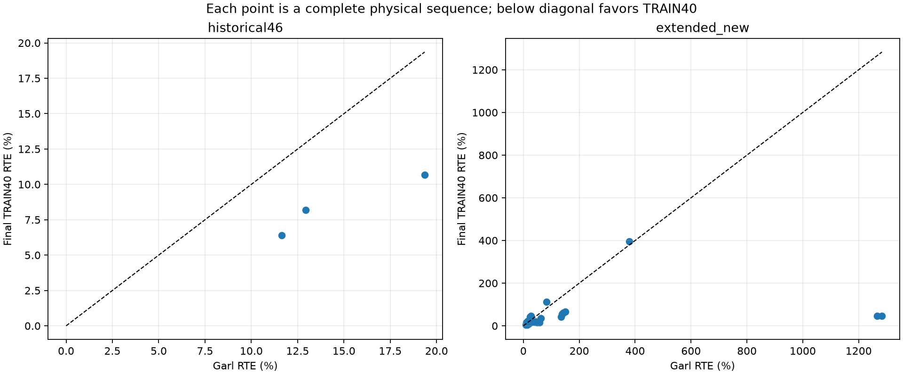

# 07. Evaluación, métricas y coste de ejecución

Este capítulo reúne resultados ya ejecutados y sus ámbitos de validez. No añade entrenamiento, inferencia ni selección de pesos. La familia final TRAIN40 mejora a Garl en la reconstrucción local EvTTC descrita aquí. Dentro de las rutas finales medidas, **R_CTX obtiene menor RTE y MAE que PHASE_ONLY**. Eso debe conservarse junto al resultado favorable del sistema multimodal: la fusión no gana en todas las poblaciones ni frente a cada componente.

Fuentes principales: [informe regenerado](../final_train40_transfer_20261027/REPORT.md), [resultados completos](../final_train40_transfer_20261027/RESULTS.json), [predicciones y targets por consulta](../final_train40_transfer_20261027/QUERIES.csv), [tabla por secuencia](../final_train40_transfer_20261027/PER_SEQUENCE.csv) y [metodología](../final_train40_transfer_20261027/METHODOLOGY.json).

## 1. Qué se congeló y cómo se evitó seleccionar con los targets

El [manifiesto previo](../../artifacts/final_train40_transfer_20261027/QUERY_MANIFEST.json) fija **554 consultas físicas únicas de 32 secuencias**. Incluye 512 consultas extendidas —hasta 16 anclas cronológicas por secuencia— y 46 consultas históricas. Cuatro anclas pertenecen a ambos conjuntos. Para no contarlas dos veces, el informe conserva 46 en `historical46` y 508 en `extended_new`. La elección de anclas utilizó disponibilidad de sensores y ROI; no TTC, error del modelo ni clasificación posterior por dificultad.

La [inscripción de la cohorte](../../artifacts/final_train40_transfer_20261027/COHORT_REGISTRATION.json) liga el manifiesto mediante SHA-256 `9a87a31a435d7922c22c479fe3a8e425e6227b8fab55109c9a2f85a91bb34d31`. Antes de abrir `ttc.csv`, el [generador del informe](../../scripts/final_train40_transfer_report.py) exige los dos sellos `PREDICTIONS_SEALED.json`, igualdad exacta de IDs, SHA de cada fragmento y los bindings de modelos. La ruta propia debe coincidir con nueve checkpoints, dos normalizadores, el sello de modelo y la receta OOF preservados. No basta con que un archivo tenga el nombre esperado.

Los sellos conservados corresponden a [Garl](../../artifacts/final_train40_transfer_20261027/garl/PREDICTIONS_SEALED.json) y a [TRAIN40](../../artifacts/final_train40_transfer_20261027/final_train40/PREDICTIONS_SEALED.json). Ambas rutas declaran cero updates y ausencia de lectura de TTC durante inferencia. El informe une por ID, no por orden de archivos. Los fallos de sensores o las predicciones ausentes permanecen en el registro y reducen cobertura; no se eliminan para mejorar una media.

El TTC se asocia después por timestamp más cercano, con tolerancia máxima de 50 ms. En un empate se elige el timestamp anterior. Se rechazan targets cero o no finitos y relojes inválidos. En esta ejecución, **40 de las 508 consultas extendidas carecen de asociación dentro de 50 ms**. Hay 468 extendidas puntuables y 46 históricas puntuables; las predicciones siguen preservadas para las 554 consultas. No son 40 fallos de predicción.

Hay una limitación adicional de identidad del target: el manifiesto usa el objeto primario de anotación y una serie TTC escalar por escenario. La tabla pública de cinco columnas no contiene un identificador TTC por objeto que permita demostrar correspondencia individual arbitraria. Los fotogramas ambiguos se excluyeron por anotaciones antes de leer TTC. Por eso estas cifras describen el adaptador y su política de selección; no certifican seguimiento multiobjeto con GT individual. La declaración exacta está en `target_linkage_limit` del manifiesto.

## 2. Métricas: consulta, secuencia y cobertura son cosas distintas

La métrica de transferencia es:

\[
\mathrm{RTE}=100\,\frac{|\widehat{\mathrm{TTC}}-\mathrm{TTC}|}{|\mathrm{TTC}|}.
\]

Se publican RTE medio, MAE en segundos, mediana y p95 de error absoluto, error de signo y cobertura. La media **pooled** da el mismo peso a cada consulta. La media **macro por secuencia** da el mismo peso a cada secuencia física, aunque tenga menos anclas válidas. No son estimandos intercambiables.

Los contrastes remuestrean secuencias completas: 2.000 draws, semilla 7. No tratan ventanas correlacionadas como observaciones independientes. Los intervalos son exploratorios: hay una única versión final de semilla 7 y EvTTC ya fue observado durante el proyecto. En la cohorte histórica solo existen tres secuencias, por lo que su intervalo no constituye una demostración amplia de generalización.

El reporte permite predicciones faltantes: en ese caso retiene la cobertura, no publica una media como si cubriera toda la cohorte y presenta por separado el subconjunto de pares finitos. Aquí todos los modelos tienen predicción finita en las consultas con GT válido. Estos RTE **no son** el agregado MiD interno de V18 ni una puntuación oficial de CodaBench.

## 3. Resultados TRAIN40 sobre las 46 consultas históricas

| Modelo congelado | Consultas con GT y predicción | RTE pooled (%) | MAE pooled (s) | RTE macro por secuencia (%) |
|---|---:|---:|---:|---:|
| PHASE_ONLY_TRAIN40_S7 | 46 | 7,7478 | 0,1409 | 8,4189 |
| Garl full publicado | 46 | 13,3273 | 0,2501 | 14,6490 |
| E_CTX_TRAIN40 | 46 | 15,8221 | 0,2864 | 15,5662 |
| R_CTX_TRAIN40 | 46 | **6,3873** | **0,1127** | **6,2459** |

La diferencia macro RTE PHASE_ONLY−Garl es −6,2301 puntos porcentuales; IC95% por secuencias [−8,6816; −4,7667]. R_CTX es el mejor de estos cuatro sistemas en esta cohorte. Los datos originales y cifras sin redondear están en [RESULTS.json](../final_train40_transfer_20261027/RESULTS.json).

El [informe anterior del 17 de octubre](../post_v18_transfer_20261017/REPORT.md) sobre esos 46 IDs registró V16 con 9,358% RTE, V18 con 9,181%, F_TRUE con **6,040%**, R_CTX histórico con 11,138% y C1 event-only con 20,954%. Son pesos anteriores y resultados preservados; no se han vuelto a entrenar ni a ejecutar para este capítulo. **F_TRUE conserva el menor RTE histórico entre esa tabla y las nuevas rutas**. No se ha evaluado F_TRUE sobre la extensión de 32 secuencias de esta entrega, de modo que no se puede trasladar allí su posición.

Garl histórico se ejecutó en CPU y el actual en CUDA. El [diagnóstico numérico entre predicciones guardadas](../../artifacts/final_train40_transfer_20261027/GARL_HISTORICAL_NUMERIC_DIAGNOSTIC.json) comprobó 46/46 hashes de sensores iguales; la diferencia TTC absoluta máxima fue 0,0002816916 s y la media 0,0000641061 s. Esa comprobación respalda la continuidad de inputs, pero no convierte ambos backends en operaciones idénticas bit a bit.

## 4. Extensión: 468 consultas puntuables en 32 secuencias

| Modelo congelado | Cobertura sobre GT válido | RTE pooled (%) | MAE pooled (s) | RTE macro por secuencia (%) |
|---|---:|---:|---:|---:|
| PHASE_ONLY_TRAIN40_S7 | 468/468 | 41,2267 | 1,0227 | 40,7335 |
| Garl full publicado | 468/468 | 140,0689 | 3,2576 | 135,5646 |
| E_CTX_TRAIN40 | 468/468 | 65,6955 | 1,4514 | 64,7493 |
| R_CTX_TRAIN40 | 468/468 | **38,5555** | **1,0154** | **38,0665** |

PHASE_ONLY presenta menor RTE por secuencia que Garl en **26 de las 32 secuencias**. Su diferencia macro es −94,8312 puntos porcentuales, IC95% [−210,5034; −14,4910]. El intervalo ancho indica heterogeneidad considerable; no debe sustituirse por la afirmación de que cada consulta o cada escenario mejora. R_CTX vuelve a superar ligeramente a PHASE_ONLY en el promedio RTE y MAE, mientras E_CTX queda por detrás de ambas rutas RGB en esta comparación. Fuentes: [tabla por secuencia](../final_train40_transfer_20261027/PER_SEQUENCE.csv), [contrastes y estratos](../final_train40_transfer_20261027/RESULTS.json).

La extensión puntuada contiene 275 targets en (0,3), 149 en [3,6), 32 en [6,10] y 12 mayores de 10 segundos. Son bins descriptivos de RTE, distintos de los límites de las bandas oficiales MiD. En el conjunto puntuable completo el TTC va de **0,496052 a 17,994177 s; no hay targets negativos**. Esta evaluación no demuestra reparación de la banda negativa, comportamiento de alejamiento ni superioridad global de signo. Los resultados por familia, tipo de target y velocidad están preservados sin escoger el estrato más favorable.

## 5. Contexto eAP y V: no mezclar poblaciones

La evaluación histórica eAP-64 dio RTE de 16,793% a Garl, 35,501% a V16, 36,227% a V18 y 29,882% a F_TRUE. Los grupos eran V para nuestros ajustes históricos, pero pertenecían al TRAIN publicado de Garl. Por tanto, esa tabla no identifica de manera limpia el efecto causal de entrenar con más datos ni constituye un test independiente para Garl. El checkpoint publicado no revela por sí solo toda su exposición efectiva. Tampoco se ha calculado un nuevo resultado TRAIN40 sobre esos grupos para presentarlo como validación: ahora forman parte del entrenamiento final. [Informe eAP-64](../post_v18_transfer_20261017/REPORT.md#eap-comparación-descriptiva-no-test-independiente-de-garl).

En V completa, 16.432 consultas y ocho grupos, el recálculo histórico seed7 dio agregado MiD 89,223 para V16, 88,270 para V18, 90,650 para F_TRUE y 93,505 para R_CTX. V18 mejoraba agregado y MAE, pero empeoraba otras bandas. Esas cifras son una semilla, no las medias de tres semillas del cierre V18. Los scores de H, V, EvTTC y test12 no se comparan entre sí como si fueran una sola escala. El cierre V18 permanece `NO_CANDIDATE` bajo sus gates originales. [V completa y decisión](../post_v18_transfer_20261017/REPORT.md#v-completa-predicciones-existentes-misma-semilla-7).

## 6. Latencias locales del 27 de octubre: qué incluye cada reloj

Se han agregado los valores `seconds` de los **554 fragmentos sellados por ruta**, incluidos los 40 que después no encontraron GT dentro de tolerancia. Los percentiles usan interpolación lineal. Son tiempos instrumentados en el PC local, con GPU RTX 5070 Ti Laptop y float32; la ruta propia calcula PHASE_ONLY y salidas de E_CTX/R_CTX compartiendo productores. No es un ensayo de dos servicios equivalentes ni una medición aislada de kernels.

| Reloj por consulta | Media (s) | p50 (s) | p95 (s) | p99 (s) | Suma de intervalos (s) |
|---|---:|---:|---:|---:|---:|
| Garl: preprocesado | 0,897359 | 0,536047 | 2,824744 | 3,926088 | 497,137 |
| Garl: tramo denominado `model` | 0,051335 | 0,029074 | 0,146199 | 0,186275 | 28,440 |
| Garl: total instrumentado | 0,948694 | 0,573145 | 2,967054 | 4,075423 | 525,576 |
| TRAIN40: preprocesado | 0,967974 | 0,734919 | 2,399160 | 4,432668 | 536,258 |
| TRAIN40: total instrumentado | 1,612098 | 1,278096 | 3,224535 | 8,304388 | 893,102 |

Fuentes regenerables: los mapas `fragments` de los sellos [Garl](../../artifacts/final_train40_transfer_20261027/garl/PREDICTIONS_SEALED.json) y [propio](../../artifacts/final_train40_transfer_20261027/final_train40/PREDICTIONS_SEALED.json), sus JSON `seconds` y los JSON serializados `own_seconds`/`garl_seconds` en [QUERIES.csv](../final_train40_transfer_20261027/QUERIES.csv). La suma de intervalos no es la duración total de la sesión: quedan fuera, según el tramo, carga inicial, validaciones, escrituras y pausas del proceso.

El tramo `model` de Garl es tiempo de pared instrumentado, no duración de kernels CUDA obtenida por profiler. El código propio desactiva TF32 para matmul y cuDNN; Garl conserva sus defaults. Además, los contextos difieren: la ruta propia puede consumir hasta 650 ms de historia causal, frente a dos imágenes y dos segmentos event con dT=0,1 s en Garl. El orden de ejecución, las cachés, el almacenamiento y la carga compartida del PC tampoco constituyen un diseño controlado. Estos números localizan gasto del adaptador, pero no sustentan una afirmación de velocidad intrínseca entre arquitecturas. [Bindings propios](../../artifacts/final_train40_transfer_20261027/final_train40/INFERENCE_FREEZE.json), [binding Garl](../../artifacts/final_train40_transfer_20261027/garl/INFERENCE_FREEZE.json).

## 7. Tres mediciones históricas que deben permanecer separadas

| Medición | Población / hardware | Resultado | Alcance |
|---|---|---|---|
| V18 desde sensores | 64 consultas V, rutas históricas emparejadas | FUSION-TRUE mediana 3,0123 s; F_TRUE 6,5882 s; R_CTX 1,9650 s | HDF5, TAR, ROI, historial, productores y transferencias; conserva batch histórico y consultas repetidas |
| Test12 final en Pod | 5.805 consultas físicas, RTX 4090 | Media 0,116336 s; p50 0,112044; p95 0,140944; p99 0,167325 | `predict()` eager con cachés/hooks; excluye preparación RAW, carga inicial y escritura de diagnósticos |
| Transferencia EvTTC local | 554 consultas por ruta, RTX 5070 Ti Laptop | Medias totales Garl 0,948694 s; propio 1,612098 s | Adaptadores y soporte temporal propios de esta comparación |

La segunda fila no demuestra una aceleración de 3,0123/0,112044 sobre V18: cambian población, modelos, preparación y alcance del reloj. Tampoco permite anunciar tiempo real desde sensores. Las 957 etiquetas alias de test12 no añaden 957 inferencias físicas ni deben inflar throughput. Fuentes: [coste histórico V18](../joint_measurement_20261012/FINAL_SCIENTIFIC_REPORT.md), [resumen final test12](D:/E_JEPA_POD2_RETURN_20261027/FINAL_CANDIDATE/diagnostics/SUMMARY.json), [metodología temporal](D:/E_JEPA_POD2_RETURN_20261027/FINAL_CANDIDATE/diagnostics/METHODOLOGY.json).

Las ventanas históricas de entrenamiento del Pod midieron 190,08 updates/min con un productor RGB A5; 368,17 con dos; 534,17 con tres; y 726,50 con tres A5 más tres C2F. El último caso mezcla trabajos distintos por update: no es un speedup de trabajo igual. La utilización GPU media observada subió de 18,55% a 95,00%, pero utilización muestreada no equivale a tiempo de kernels ni a ausencia de espera de datos. [Ventanas preservadas](D:/E_JEPA_POD2_RETURN_20261027/FINAL_CANDIDATE/diagnostics/HISTORICAL_THROUGHPUT.json).

## 8. Qué permite afirmar la entrega

Se dispone de una comparación local con pesos congelados, anclas registradas antes de GT, cobertura explícita, controles de fuga y resultados por secuencia. TRAIN40 PHASE_ONLY mejora frente a Garl en las dos cohortes locales y conserva un resultado peor que R_CTX en sus promedios. La evaluación ampliada cubre más escenarios y TTC positivo largo que las 46 consultas, pero no negativos ni un test ciego nuevo. El ZIP oficial está preparado; **no se ha enviado y no hay score oficial de test12 en esta evidencia**. La preparación técnica y una mejora de transferencia no son una proclamación de SOTA.
