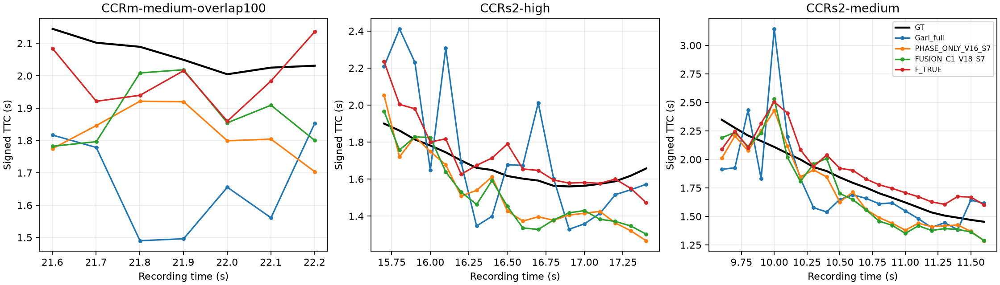

# Comparación congelada posterior a V18 — 17-10-2026

**Ejecutado:** inferencia nueva de seis sistemas sobre 46 consultas EvTTC; Garl full sobre 64 consultas eAP; recálculo de cuatro sistemas en las 16.432 consultas V ya guardadas. Cero optimizer updates, cero refit y ningún envío oficial. V18 conserva `NO_CANDIDATE`.

La autorización posterior del usuario («haz esos análisis y comparaciones») habilita esta comparación congelada. El protocolo anterior era una propuesta no ejecutada. Esta reconstrucción EvTTC no se identifica con su comparación FCWD: FCWD usa otra población/cámara y no aporta un mapeo validado para el Garl full de esta comparación.

## EvTTC: consultas emparejadas en los intervalos comunicados

Pesos seed7 fijados; ningún ensemble ni selección de semilla. `PHASE_ONLY_EVENT_S7` es un sistema RGB+eventos: EVENT identifica la contribución de fase, no una modalidad exclusivamente de eventos. C1_event sí es event-only; R_CTX es RGB. F_TRUE, V18 y Garl full son RGB+eventos.

| Sistema | RTE (%) | MAE (s) | Mediana AE (s) | p95 AE (s) |
|---|---:|---:|---:|---:|
| Garl_full | 13.329 | 0.250 | 0.186 | 0.561 |
| PHASE_ONLY_V16_S7 | 9.358 | 0.167 | 0.154 | 0.334 |
| FUSION_C1_V18_S7 | 9.181 | 0.161 | 0.154 | 0.343 |
| F_TRUE | 6.040 | 0.110 | 0.085 | 0.316 |
| R_CTX | 11.138 | 0.197 | 0.190 | 0.371 |
| C1_event | 20.954 | 0.408 | 0.216 | 1.241 |

Menor error es mejor. RTE = 100·|pred−GT|/|GT|, media por consulta; MAE en segundos. Cobertura de predicción y GT: 46/46 en todos los sistemas. Sin eliminar outliers, sin clipping añadido y sin calibrar los pesos o la conversión tras ver GT.

**F_TRUE histórico obtiene el menor RTE y MAE de esta cohorte.** V16 y V18 mejoran a Garl full en los tres grupos, pero V18 sólo mejora a V16 en CCRm; empeora ligeramente en los dos CCRs2. No hay un reemplazo universal demostrado.

| Escenario local | N | Garl RTE | V16 RTE | V18 RTE | F_TRUE RTE |
|---|---:|---:|---:|---:|---:|
| CCRm-medium-overlap100 | 7 | 19.359 | 11.587 | 8.775 | 4.958 |
| CCRs2-high | 18 | 12.943 | 9.903 | 10.033 | 4.823 |
| CCRs2-medium | 21 | 11.650 | 8.147 | 8.585 | 7.443 |

El contraste macro por grupo V18−V16 es -0.748 puntos RTE; IC95% bootstrap [-2.812, 0.439]. Se remuestrean tres secuencias completas, 2.000 veces, seed7. El intervalo incluye cero. Es exploratorio: sólo tres grupos, ventanas correlacionadas, desarrollo EvTTC previamente observado y varios contrastes; no es confirmación independiente. La media macro del contraste y la media por consulta de la tabla son estimandos distintos.

Los targets cubren 1.454–2.347 s; todos son positivos. Esta cohorte no prueba precisión negativa, TTC largo, receding ni la corrección de A1-FULL. Un error de signo nulo aquí tiene alcance limitado.



## eAP: comparación descriptiva, no test independiente de Garl

Ocho IDs equiespaciados en el orden lexicográfico de sample_token de cada grupo V: 64 consultas fijadas sin seleccionar por GT, banda o error. Garl se ejecutó de nuevo; los otros cuatro sistemas reutilizan sus predicciones exactas selladas sobre esos IDs. En la primera consulta de cada grupo se comprobó igualdad bit a bit entre sensores del preprocesado local y el upstream: ocho comprobaciones satisfechas.

| Sistema | RTE (%) | MAE (s) | Mediana AE (s) | p95 AE (s) |
|---|---:|---:|---:|---:|
| Garl_full | 16.793 | 0.857 | 0.552 | 2.489 |
| PHASE_ONLY_V16_S7 | 35.501 | 2.301 | 0.809 | 13.138 |
| FUSION_C1_V18_S7 | 36.227 | 2.399 | 0.713 | 6.095 |
| F_TRUE | 29.882 | 1.836 | 0.878 | 6.391 |
| R_CTX | 37.433 | 2.489 | 0.602 | 12.383 |

Garl full gana en RTE y MAE en este subconjunto. Los ocho grupos V figuran en `E:/Garl-TTC/configs/splits/train.txt` (46 IDs publicados). Por ello la independencia para Garl no está establecida; ese listado tampoco certifica por sí solo toda la genealogía del checkpoint publicado. No extrapolar las 64 consultas a todo eAP. No hemos sustituido el subconjunto por otro más favorable.

## V completa: predicciones existentes, misma semilla 7

| Sistema | Agregado MiD | MiDc | MiDs | MiDl | MiDn | MAE (s) |
|---|---:|---:|---:|---:|---:|---:|
| PHASE_ONLY_V16_S7 | 89.223 | 131.837 | 48.616 | 40.113 | 47.081 | 1.870 |
| FUSION_C1_V18_S7 | 88.270 | 127.661 | 51.025 | 42.969 | 48.355 | 1.817 |
| F_TRUE | 90.650 | 131.501 | 52.740 | 42.788 | 47.986 | 2.003 |
| R_CTX | 93.505 | 138.634 | 50.841 | 41.204 | 48.154 | 1.884 |

16.432 consultas y ocho grupos, sin inferencias nuevas. Estos números son seed7, no las medias de tres semillas del cierre V18. V18 mejora agregado y MAE frente a V16, pero empeora MiDs, MiDl y MiDn. V sigue siendo desarrollo observado. No comparar estos MiD con los RTE EvTTC ni con scores de H.

## Alcance y decisión

La comparación nueva sostiene conservar V18 como alternativa; no sostiene sustituir V16 ni descartar F_TRUE. Se mantiene el candidato oficial V16 congelado. Para conocer la posición oficial falta un recibo de CodaBench y resolver elegibilidad de modalidad e historial; esta tarea no envía nada ni demuestra SOTA. No se consultó GT privado ni se usaron estos resultados para ajustar pesos, semillas o clipping.

El [diagnóstico A1 anterior](../post_v18_20261017/A1_NEGATIVE_ANALYSIS.md) conserva la descomposición de dirección, magnitud y saturación sobre P. Esta evaluación no ejecuta A1-FULL ni una ablación de gradientes y no cambia esa conclusión.

La latencia registrada es CPU FP32, dos hilos: Garl tiene una ruta individual; la ruta propia calcula cinco sistemas con productores compartidos. No son latencias comparables de dos productos ni reproducen el hardware de la Tabla VI. Las cifras por fase permanecen en EVTTC_RESULTS.json; no se afirma tiempo real.

## Evidencia y reproducción

[Auditoría del correo y diferencias](AUTHOR_PROTOCOL_AUDIT.md), [EvTTC JSON](EVTTC_RESULTS.json), [consultas EvTTC](EVTTC_QUERIES.csv), [eAP-64 JSON](EAP_64_RESULTS.json), [consultas eAP-64](EAP_64_QUERIES.csv), [V completa JSON](EAP_V_RESULTS.json), [V completa CSV](EAP_V_EXISTING_PREDICTIONS.csv). Los registros previos, manifiestos, recibos y predicciones nuevas se conservan en `evidence/`; no contiene datos crudos ni checkpoints.

Desde la raíz, con el entorno local del proyecto y `PYTHONPATH=src;.`:

```powershell
python -B -m scripts.post_v18_transfer_report evttc
python -B -m scripts.post_v18_transfer_report eap
python -B -m scripts.post_v18_transfer_report report
```

Esto sólo vuelve a puntuar predicciones selladas y genera documentación. Para reproducir inferencia en otro entorno, respetar las rutas locales declaradas en REGISTRATION y los SHA de padres; los runners `post_v18_transfer_compare` y `post_v18_eap_compare` rechazan registros incompatibles y reanudan fragmentos completos sin sobrescribirlos. No ejecutar `register` sobre un registro existente. El checkout necesita los artefactos de las ramas hermanas y los datasets locales; la evidencia publicada por sí sola permite inspección, no reconstruye los sensores.
