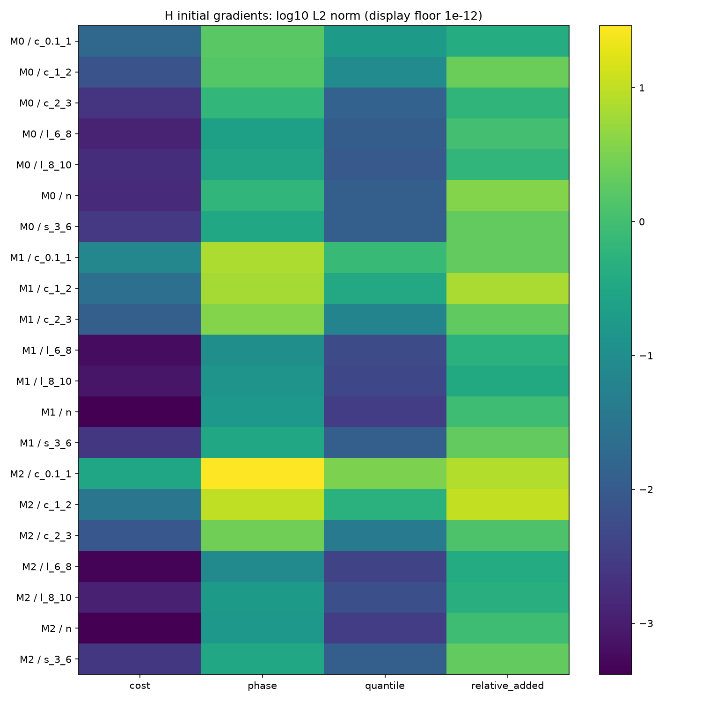

# 02. Masa, gradientes y atribución del sesgo

## Cuántos ejemplos cortos existen en H

H reúne 18.422 filas y ocho grupos. Sólo 52 filas están en (0,1;1] segundos. La tabla cuenta tracks y episodios descriptivos, definidos como tramos del track separados por más de un segundo. Esos episodios no garantizan escenas independientes.

| Subrango | Filas | Tracks | Episodios | Masa M0 % | Masa M1 % | Masa M2 % | Draws esperados |
| --- | --- | --- | --- | --- | --- | --- | --- |
| c_0.1_1 | 52 | 29 | 29 | 0.314 | 1.357 | 5.428 | 903.3 |
| c_1_2 | 524 | 105 | 111 | 2.967 | 12.907 | 19.161 | 9102.2 |
| c_2_3 | 1251 | 145 | 162 | 6.745 | 35.736 | 25.411 | 21730.5 |
| s_3_6 | 5261 | 196 | 296 | 29.438 | 30.000 | 30.000 | 91386.4 |
| l_6_8 | 2351 | 160 | 324 | 13.225 | 6.373 | 5.000 | 40838.1 |
| l_8_10 | 1357 | 147 | 296 | 7.513 | 3.627 | 5.000 | 23571.8 |
| n | 7626 | 156 | 292 | 39.798 | 10.000 | 10.000 | 132467.7 |

En el conjunto crucial completo, M0 asigna cerca del 10 % de la masa; M1 y M2 asignan el 50 %. Para ≤1 s, el cap de M2 limita el aumento a cuatro veces M1. La mayor presión no añade información ni cambia la frecuencia de muestreo.

En 2.500×128 draws uniformes, cada fila aparece 17,37 veces en esperanza. El draw realizado seed7 cubrió todas las filas; el máximo observado fue 36 apariciones para una fila. H_EXPOSURE.csv, incluido en el bundle, contiene los conteos por token.

MASS_AUDIT.csv y H_METADATA_AUDIT.json describen la auditoría inicial de metadatos. El segundo conserva `FEATURE_GRADIENTS_PENDING` y `native_final_cache_audited=false` por su scope original. Para el estado final hay que consultar H_FINAL_CACHE_AUDIT.json, GRADIENT_AUDIT.json y la admisión, que sí documentan la caché final y los gradientes. Conservo ambos momentos sin sobrescribir su significado.

## Gradientes prefits

Medí por separado fase, cuantiles, costes y el término relativo añadido sobre batches H fijados por hash, con la inicialización seed7. No ejecuté optimizer.step en ese diagnóstico. GRADIENT_AUDIT.csv conserva 84 filas: siete rangos, tres masas y cuatro términos, además de fracciones de cap y clamp.

En ≤1 s, la norma de gradiente del término de fase pasa aproximadamente de 1,681 (M0) a 7,285 (M1) y 29,139 (M2). Para el término relativo añadido pasa de 0,416 a 2,029 y 8,118. Estas normas miden presión local al inicio, no el efecto final en V. No cambié el coeficiente 0,25 después de medirlas.

El gráfico muestra log10 de la norma; el suelo 1e−12 sirve sólo para dibujar. Las cifras sin esa transformación están en [GRADIENT_AUDIT.csv](evidence/GRADIENT_AUDIT.csv).

## Controles H y trazas por productor

Seleccioné 32 consultas H por hash, cubriendo los rangos disponibles. Ejecuté la cabeza nativa final V13 sobre su caché, y comparé su salida con la mediana de expertos al suprimir el residual. Durante el factorial completé además las trazas crudas de A5/C2F/PAIR sobre 118 observaciones reales de esos controles. Esas trazas adicionales no cambiaron el código, las features ni los hiperparámetros del factorial.

| Rango | Productor | Consultas | Sesgo productor s | Analítico log-ratio | Residual log-ratio | Sesgo mediana s | Sesgo cabeza nativa s |
| --- | --- | --- | --- | --- | --- | --- | --- |
| 0.1-1 | E_A5_MATCHED | 4 | 1.293 | 0.006820 | 0.045454 | 1.026 | 0.573 |
| 0.1-1 | E_C2F_MATCHED | 4 | 1.147 | 0.010331 | 0.046669 | 1.026 | 0.573 |
| 1-2 | E_A5_MATCHED | 4 | 0.633 | 0.004336 | 0.040599 | 0.682 | 0.495 |
| 1-2 | E_C2F_MATCHED | 4 | 0.706 | 0.003771 | 0.040035 | 0.682 | 0.495 |
| 2-3 | E_A5_MATCHED | 4 | 0.579 | 0.001731 | 0.031783 | 0.548 | 0.256 |
| 2-3 | E_C2F_MATCHED | 4 | 0.429 | 0.002768 | 0.032919 | 0.548 | 0.256 |
| 3-6 | E_A5_MATCHED | 8 | 2.541 | 0.000257 | 0.022088 | 2.441 | -0.270 |
| 3-6 | E_C2F_MATCHED | 8 | -1.525 | -0.000169 | 0.018719 | 2.441 | -0.270 |
| 6-8 | E_A5_MATCHED | 4 | 2.274 | 0.000049 | 0.015414 | -0.830 | 1.955 |
| 6-8 | E_C2F_MATCHED | 4 | -0.596 | 0.000042 | 0.019498 | -0.830 | 1.955 |
| 8-10 | E_A5_MATCHED | 4 | 5.936 | -0.000781 | 0.009659 | 4.080 | -5.982 |
| 8-10 | E_C2F_MATCHED | 4 | 2.726 | -0.000903 | 0.012026 | 4.080 | -5.982 |
| negative | E_A5_MATCHED | 4 | -13.920 | 0.000205 | -0.008933 | -13.761 | 0.837 |
| negative | E_C2F_MATCHED | 4 | -13.511 | 0.000230 | -0.009111 | -13.761 | 0.837 |

Un sesgo positivo significa sobreestimación. En los cuatro controles ≤1 s, A5 y C2F ya sobreestiman antes de la cabeza; el residual de la cabeza reduce el sesgo de la mediana, pero no lo elimina. En otros rangos aparecen cambios de signo o deterioros. Esta muestra fija permite localizar comportamientos; no estima causalidad en toda H ni demuestra que la cabeza sea la única causa del problema.

El selector interno fino/grueso de C2F, su flujo, alturas, log-ratios, soporte y máscaras quedan en los fragmentos y CSV del bundle. Los costes auxiliares de la cabeza no son pesos de un router H8.

## Fallo de forma known y adaptación diagnóstica

La primera traza matched falló con `producer known mask differs from support clock`. El productor emite known booleano por consulta, forma `[B]`, y soporte temporal `[B,3]`. El adaptador nativo exigía que ambas formas coincidieran. Reproduje el error y guardé la evidencia; no modifiqué V13.

En un script diagnóstico separado validé la forma real de known y construí las mismas 133 features PAIR mediante la función nativa pair133: token128, dt, log(dt), 1/dt, soporte actual y mínimo anterior/actual. La prueba compara esos campos y rechaza máscaras expandidas e intervalos inválidos. No añadí known a las features ni fabriqué timestamps.

La ruta adaptada completó las 118 observaciones. El máximo delta de fase CPU frente a la caché GPU fue 6,704e−5; no afirmo igualdad bit a bit de toda la ruta de productores. La adaptación no se usó para entrenar las seis cabezas y no resuelve ni publica una corrección de Dev32 en V13.

## Evidencia V12/FCWD histórica

El recálculo público conservó 597 consultas elegibles de 630, 33 exclusiones y 3 secuencias. mean_MiD H8 fue 79.951793, frente a 61.816523 del comparador Garl. No había targets ≤1 s. overall_MiD permanece ausente por soporte de bandas incompleto.

Ejecuté 96 forwards de cabezas históricas en 32 consultas publicadas y vecinos, además de 512 observaciones de productores. Los pesos TRAIN40 aparecen sólo en esta explicación histórica V12. Los pesos del factorial V14 son matched P-only.

FCWD y Dev32 son desarrollo expuesto. No usé sus etiquetas para ajustar o seleccionar las recetas V14. La evidencia histórica no constituye confirmación externa, una nueva evaluación de los seis endpoints ni una afirmación de SOTA universal.

Fuentes: [masa](evidence/MASS_AUDIT.csv), [atribución H](evidence/matched_H_raw_producers/ATTRIBUTION_BY_RANGE.csv), [traza adaptada](evidence/matched_H_raw_adapted/RESULT.json), [fallo original](evidence/matched_H_raw/FAILURE.json), [recálculo FCWD](evidence/public_analysis/ANALYSIS.json).
